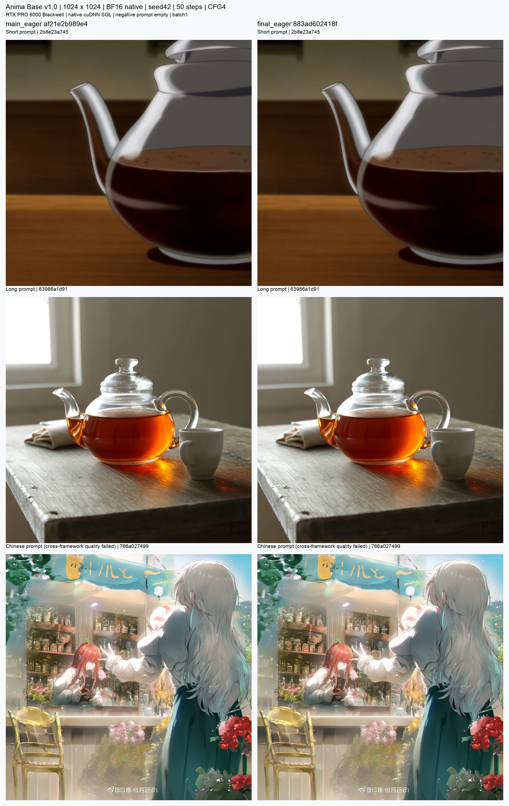
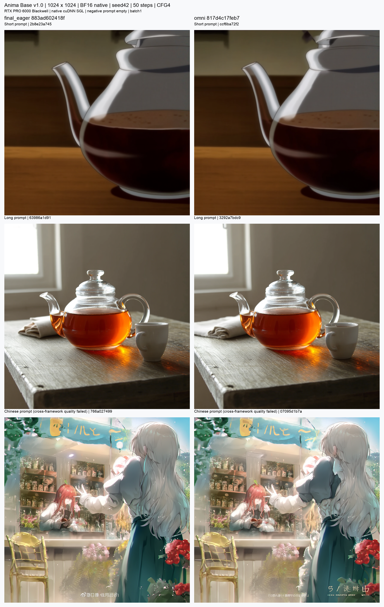

# Anima FP32 RoPE rounding on RTX PRO 6000

This branch contains evidence only. The code change is commit `883ad602418f51dc406378e1a5aa0ba8438f6b27`, based on SGLang `af21e2b989e482cfdce39689126562f2209d53ac`. Native Omni is `817d4c17feb702289a2d2b2cbacfd594c262b7a7`.

All raw measurement blocks and negative/failed results are retained. Repeated PNG files are deduplicated by SHA-256 under `images/by-sha256`; `image-path-map.json` maps every original path. Response-metrics exports omit only duplicate base64 image data and record the original response hash. Full original responses, tensor snapshots and codegen binaries remain in four verified local archives; public archive member manifests and omitted-binary hashes permit auditing. No model weights are included.

## Reproduction layout

The runners preserve the measured deployment paths: host root `/data/xyzhang/diffusion-rtx6000-20261026`, mounted as `/task` inside the two task-owned SGLang/Omni containers. The native launchers and block metadata contain complete environment settings and command arrays. Recreate the pinned repositories, version-pinned Python environments, and verified checkpoint paths before running them; if using different host paths, update the paths and hash guards explicitly rather than silently bypassing the guard.

1. Put the files from `reproduce/` in the host root and `inputs/` under that root. Preserve the repository/worktree paths referenced by the plans. Build V1 by applying `evidence/preflight/anima-rope-v1.patch` to the frozen main; final uses the commit above.
2. Obtain the two pinned official Anima checkpoint layouts recorded in `evidence/downloads/`. Verify every runtime file hash and the 685-tensor equivalence audit. Do not send authentication tokens to download mirrors.
3. Confirm the physical GPU UUIDs in the block metadata/NVML samples. The launchers require idle GPUs and use GPU0. Native Omni compile stays enabled; SGLang compile stays disabled in eager/BCG comparisons.
4. Copy the selected `evidence/plans/*.json` to the host root. `run_anima_blocks2.py` runs primary, cleanup and compatibility sequences on the host, orchestrating the owned containers. `run_anima_blocks3.py` runs synchronized diagnostics. Plans include source, input and harness hashes; output locations must be fresh because previous results must not be overwritten.
5. The minimal native final launcher invocation and exact per-process request/benchmark arrays are below and in `evidence/block-runs/*/metadata.json`. `run_anima_rope_final_tests1.py` reproduces the existing eight Anima tests. `audit_anima_blocks1.py`, `audit_anima_bcg2.py`, `summarize_anima_final.py` and `admit_anima_final.py` show all calculations and gates.

## Validation report

## Motivation and change

On RTX PRO 6000 Blackwell, the existing Anima FP32 split-half RoPE kernel fails its first-use exactness check and falls back to eager. Triton 3.8.0 emits contracted arithmetic in the FP16/BF16-output specialization even with `enable_fp_fusion=False`: the inspected original cubin contains eight `FFMA` instructions, and the captured Q/K case has 90 differing values. The guard prevents incorrect model outputs, but leaves the intended fusion unused.

Use the existing `mul_rn_f32` helper for both products before their FP32 addition and output cast. The inspected replacement cubin has no `FFMA`; the existing exactness gate passes and real Anima serving uses the fused kernel. The gate, supported shapes/dtypes, quality policy, fallback and compile behavior are unchanged. The only other change documents the operator in its existing README table.

Frozen SGLang main: `af21e2b989e482cfdce39689126562f2209d53ac`.
Final tested PR head: `883ad602418f51dc406378e1a5aa0ba8438f6b27`.
vLLM-Omni: `817d4c17feb702289a2d2b2cbacfd594c262b7a7`.

[Evidence index](README.md), [numerical/codegen audit](evidence/preflight/anima-rope-numerics2.json), [existing tests](evidence/block-runs/anima-rope-final-tests1/final.log).

## Final-head model measurements

One RTX PRO 6000 Blackwell Server Edition, SM120, 97,887 MiB, 600 W, driver 595.84. The same physical GPU0 serves every arm; GPU1 remains idle. SGLang uses PyTorch 2.14.1+cu130 / Triton 3.8.0; Omni uses PyTorch 2.13.0+cu130. Dependency pins and NVML samples are archived.

Anima Base v1.0, 1024×1024, 50 steps, CFG 4, CPU seed 42, empty negative prompt, maximum 512 text tokens, batch/concurrency 1. Components run BF16; initial noise and solver arithmetic retain the native FP32 contract. SGLang uses its native pipeline and cuDNN attention, lossless quality. Omni uses native single-file loading plus components, cuDNN attention, and its default **28 regionally compiled transformer blocks**, retained throughout.

Primary measurements have no profiler and no added stage synchronization. A symmetric 12-process sequence contains two processes per configuration; each prompt has one warmup plus four measured requests per process (**n=8/config/prompt**). HTTP time includes the complete PNG/base64 response transfer and excludes client PNG decoding/disk writes. Throughput is serial requests divided by their summed HTTP time. Denoise below is from separate synchronized SGLang diagnostics, n=4/config/prompt, and is not subtracted from primary HTTP latency. Omni's API generation-stage metric also includes other stages; a comparable isolated denoise value was not collected.

| Configuration | Prompt | E2E p50 / p95 (s) | req/s | Peak GiB | Synchronized denoise (s) |
|---|---|---:|---:|---:|---:|
| omni | short | 5.7682 / 5.7721 | 0.17342 | 11.494 | not collected |
| omni | long | 5.7998 / 5.8044 | 0.17248 | 11.494 | not collected |
| main_eager | short | 7.0910 / 7.1061 | 0.14097 | 7.576 | 6.8552 |
| main_eager | long | 7.0905 / 7.0949 | 0.14108 | 7.576 | 6.8496 |
| final_eager | short | 6.1622 / 6.1710 | 0.16225 | 7.531 | 5.9337 |
| final_eager | long | 6.1618 / 6.1659 | 0.16230 | 7.531 | 5.9304 |
| main_bcg | short | 7.0884 / 7.1109 | 0.14100 | 8.812 | 6.8205 |
| main_bcg | long | 7.0907 / 7.1012 | 0.14105 | 8.812 | 6.8154 |
| final_bcg | short | 6.1884 / 6.1985 | 0.16156 | 8.718 | 5.9190 |
| final_bcg | long | 6.1908 / 6.1973 | 0.16152 | 8.718 | 5.9198 |

Paired process-median comparisons, short / long prompt:

- **Main → PR eager:** latency **−13.10% / −13.08%**; all process pairs improve.
- **Main → PR BCG:** latency **−12.73% / −12.70%**; all process pairs improve.
- **Omni remains faster:** PR eager is **6.88% / 6.27% slower**. This PR does not establish a cross-framework win.
- **BCG has no net benefit here:** final BCG is **0.40% / 0.47% slower** than final eager and uses about **1.188 GiB** more peak memory. This is existing BCG compatibility, not new beneficial BCG coverage.

Before comparisons, native-main A/A had CV 0.037–0.058% and maximum half-run median drift 0.098%. The first V1 ABBA independently showed 13.15% / 13.09% lower latency. All samples, backend screens, negative comparisons and quality failures are retained in the [raw audit](evidence/preflight/anima-rope-final-compare1-audit.json); [summary](evidence/preflight/anima-rope-final-summary.json).

Cached launch-to-ready times were 44.03–48.04 s for PR eager, 44.03–46.04 s for PR BCG, about 46.03–46.04 s for main, and 38.02–38.03 s for Omni. These reuse existing disk/compiler caches and are **not cold-start measurements**. In a separate final-head observer run, native graph construction took 0.617 s on main and 0.587 s on PR; the complete warmup denoising call took 7.310 s / 6.402 s. These are single observed warmups, not repeated cold-start estimates.

## Profile and BCG execution

Separate synchronized profiles, representative GPU step 3:

| Configuration | GPU kernels | Sum of GPU kernel times (ms) | Fused paired RoPE calls |
|---|---:|---:|---:|
| main eager | 3326 | 135.694 | 0 |
| PR eager | 2486 | 117.836 | 56 |
| main BCG | 3330 | 134.300 | 0 |
| PR BCG | 2490 | 116.026 | 56 |

These diagnostic sums are not primary serving latency. [Final profile audit and trace paths](evidence/profiles/anima-rope-final-profile-audit.json).

Final-head BCG checks switch short → long → Chinese → repeated short, then lossless → exact → high → lossless at the same shape. Each arm has one actual warmup capture with 57 segments, **17 serving requests, 900 model-level replays, and zero serving capture calls**. Exact/high use the native uncaptured path; returning to lossless reuses the existing graph. All 17 images per arm match the corresponding native-main PNG exactly. The lossless profile contains 456 `cudaGraphLaunch` events across its four captured GPU-step annotations; the fused RoPE is present inside PR execution. The counter observer adds no tensor reads or CUDA synchronizations and is excluded from primary timing. [Lifecycle audit](evidence/preflight/anima-final-bcg-audit2-audit.json).

## Correctness and actual generated images

The original single-file DiT is pinned to `circlestone-labs/Anima@f973fc41ec7545364ac9776c2440285f43ff2a30`; components are `circlestone-labs/Anima-Base-v1.0-Diffusers@073c3a9db359c31ad0e8aa268d15775473c2176c`. All downloaded files have verified hashes; the native converter establishes exact equality for all **685 DiT/conditioner tensors**. Both frameworks receive equal Qwen/T5 token IDs and masks, initial noise, timesteps and sigmas. Their native BF16 text-encoder/conditioner results have small numerical differences; these are audited rather than silently replaced.

Main versus final PR: byte-identical PNGs for short, long, Chinese and repeated short in eager/BCG and the tested quality transitions. Cross-framework admission was fixed at SSIM ≥0.95 and PSNR ≥28 dB:

| Prompt | cuDNN SGLang / Omni SSIM | PSNR (dB) | Result |
|---|---:|---:|---|
| short | 0.983579 | 37.1984 | pass |
| long | 0.974539 | 30.4278 | pass |
| Chinese | 0.936743 | 26.5305 | **fail; excluded from performance admission** |

The Chinese prompt asks for a teapot scene and “慢慢喝茶”; both frameworks instead generate anime café figures, with differences in hands/text. This failure is shown below and remains in the matrix. English images preserve the same composition with small reflection/cloth differences. Native torch-SDPA screens also retain their Chinese quality failure. An explicit `fa` screen resolved to torch SDPA under the existing SM120 policy; it is not evidence of a FlashAttention run.

Real main / final images, 1024×1024, seed 42, 50 steps, CFG 4, BF16, identical prompts. Rows are short, long and Chinese; labels identify the commits and the failed cross-framework row. Original image pixels are unchanged in these panels.






[Image manifest and visual review](media/manifest.json); [effective-input audit](evidence/preflight/anima-runtime-input-audit1.json).

## Cleanup, tests and reproduction

Reused the existing numerical helper and existing tests; no new wrapper, flag, test copy or gate bypass. Scoped review removed experimental code from the production diff. Final executable kernel bytes equal the pre-cleanup V1 bytes; the final commit adds the necessary operator documentation.

The original cleanup comparison gave final latency +0.1365% / +0.0884%. One fixed supplementary ABBA, two warmups and eight measurements per prompt/process, gave +0.0187% / +0.0108%. Keeping all four process pairs gives **+0.0776% / +0.0496%**, n=24 per arm/prompt. All four point estimates are slightly negative for the final version; we do not call the difference zero. Descriptive 95% process-paired log-ratio t intervals are [0.99813, 1.00032] and [0.99863, 1.00038] for V1/final, including no change and satisfying the predeclared 1% noninferiority margin. Only four process pairs limits precision. Final-head gains over main remain above 12%; no further favorable-result retries were run. [Complete cleanup audit](evidence/preflight/anima-rope-final-cleanup-admission.json).

- Existing Anima tests (`test_rope.py`, `test_model_fast_paths.py`, `-k anima`): baseline **3 failed / 5 passed**, final **8 passed** on SM120. Seven captured/synthetic FP16/BF16 numerical cases also pass exactly.
- Scoped pre-commit checks and `git diff --check` pass. Initial harness permission/root assertions and their corrections are retained; they did not alter model code.
- [Frozen workload](inputs/anima-t2i-workloads.json), [launch/request/benchmark commands per process](evidence/block-runs/anima-rope-final-compare1-03-final_eager/metadata.json), [reproduction instructions](README.md).

```bash
# In the pinned SGLang environment, with the verified component checkpoint:
SGL_REPO=/task/candidates/anima-rope-rounding-final \
SGL_EXPECTED_HEAD=883ad602418f51dc406378e1a5aa0ba8438f6b27 \
  sh /task/launch_sgl_anima_cudnn_primary1.sh
# The archived launcher supplies the complete native server arguments.
python3 bench_anima_serving.py sgl --help
# Reproduce the fixed sequence with the archived plan and runner:
python3 run_anima_blocks2.py anima-rope-final-compare1.json
```

Scope: the measured native single-GPU Anima workload and conservative existing RoPE contract. Other resolutions, batches/concurrency and GPU generations are unrun. Omni rejects the tested model's TP/SP/parallel-CFG/quantization/offload combinations; no unsupported two-GPU comparison is claimed. No full-matrix or new BCG win is claimed. Weights, traces and media are kept outside the code PR.
