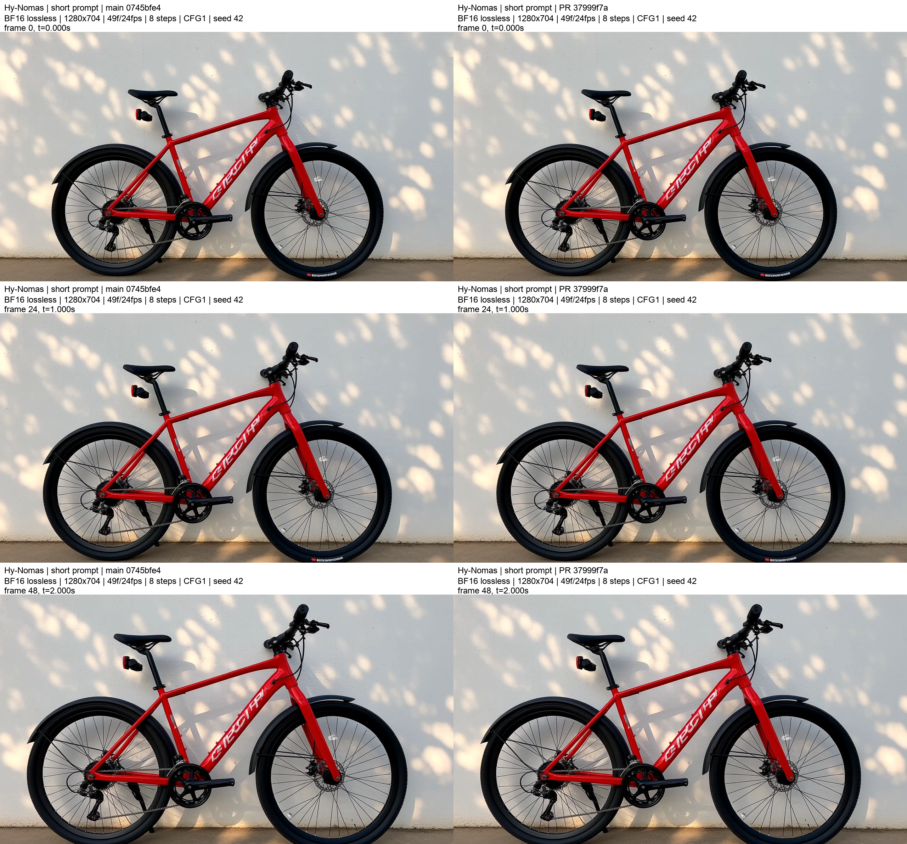
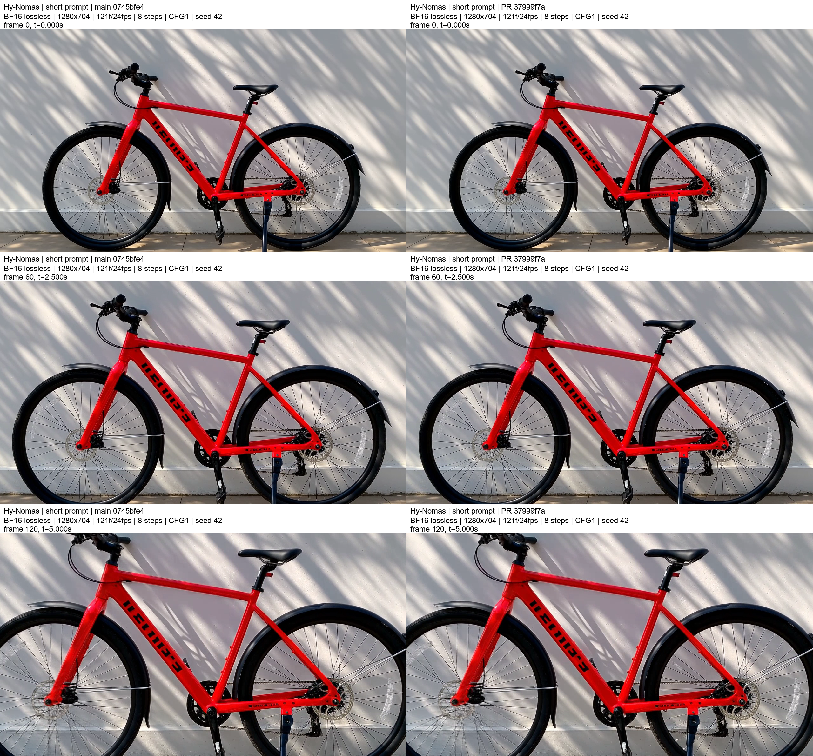
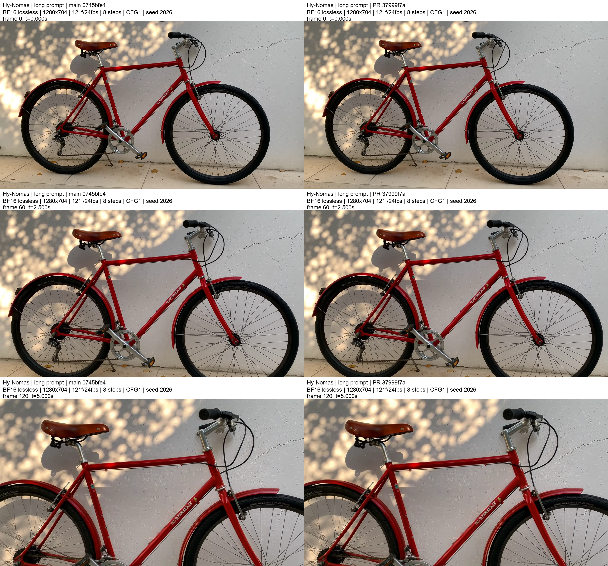
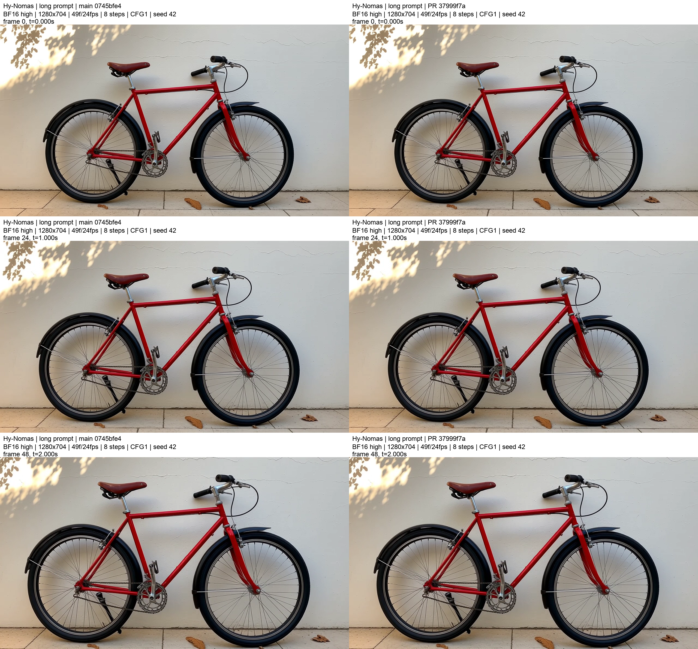
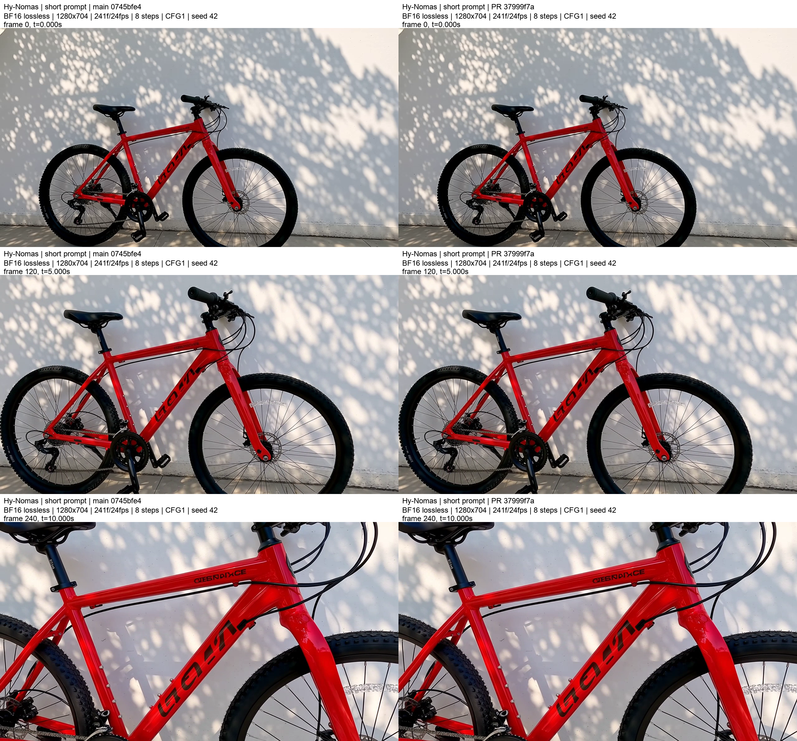
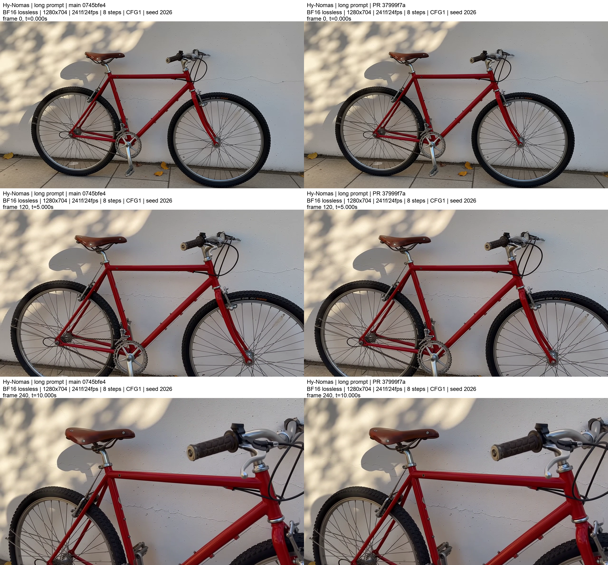

**Evidence availability update:** the three-round report below includes every measured latency sample and every round, with original source heads unchanged. Complete raw archives were created on the 6000 host with per-file SHA256 receipts. SSH interrupted the local archive copies on 2026-11-15; this supplement publishes the verified reports, commands and hash manifests available locally. The remaining raw-file mirror is pending reconnection. Previously published actual main/PR images and videos remain available. The supplemental raw-file mirror remains incomplete; the previous raw archive and generated comparisons remain available.

# Fuse the ordered mean-square reduction in Nomas VAE

Nomas VAE currently materializes FP32 squares before reducing them. This change reuses the existing ordered mean-square operator for contiguous width 4096 and head-64 views, including either half of packed head-128 Q/K tensors. It removes 722 intermediate square launches per 49-frame generation while preserving ATen's reduction order and the existing normalization rounding. Unsupported layouts keep the original implementation through the existing per-signature `BitExactFusionGate`.

Main baseline: `0745bfe49b855ae48e0c1ef3305362b8e0c78a03`.
Final PR head: `37999f7ab31809bd8a9f3cabee3fa50c54f179d6`.
vLLM-Omni baseline: `aa2968e858a718989332a61ad40758024cb4a3a5`.
Pre-cleanup candidate: `fbfb89d4c73ae6adc1d2d769af4a34a4cd881541`.

## End-to-end measurements

One **RTX PRO 6000 Blackwell Server Edition**, 97887 MiB, SM120, driver 595.84; physical GPU0 UUID `GPU-1565b45e-a702-2015-9776-61f68c36fd59`. The task's maximum budget is two GPUs, connected through SYS without NVLink; all performance measurements below use the same single GPU. The supplemental Ulysses2 correctness checks use both physical GPUs. These are current-machine results.

Native SGLang backend, resident BF16 weights, lossless quality, 1280×704, 49 frames at 24 FPS, 8 denoising steps, CFG1, flow shift5, CPU seed42, batch1/concurrency1. Short and long structured prompts are fixed in [the input manifest](https://github.com/BBuf/sglang/blob/9473cba216404611937d488804a56682f83882e7/inputs/nomas-native-workloads01.json). Full-model `torch.compile` and BCG are disabled. Existing intrinsic FlexAttention compilation and pointwise fast paths remain active in both arms. H.264 encoding uses CRF18/ultrafast in both native frameworks; the claim is identical generated main/PR MP4 bytes and decoded frames, not an uncompressed video codec.

| Prompt | Main E2E p50 / p95 s | PR E2E p50 / p95 s | Paired speedup | E2E reduction | Observed noise |
|---|---:|---:|---:|---:|---:|
| short | 8.2963 / 8.3123 | 8.1446 / 8.1606 | 1.018480x | 1.814% | 0.590% |
| long | 8.3234 / 8.3417 | 8.1738 / 8.1860 | 1.018884x | 1.853% | 0.554% |

Three independent **A-B-B-A rounds**, with six fresh-process visits per arm in total. Each visit has two excluded warmups and six measurements alternating short/long: **n=18 per prompt per arm**. The original published round is retained, followed by two prospectively declared rounds on the unchanged main/PR commits and configuration. Fresh-process A/A precedes the added rounds. All 96 outputs in the three final rounds and all 16 fresh A/A outputs match the native reference MP4 SHA256. The earlier cleanup and separate stage outputs remain exact.

Same ordinal requests are paired within each round and prompt. The table reports the geometric mean of the three round speedups. Observed noise is the larger of fresh A/A noise and either arm's pooled full range. Fresh A/A noise is 0.366% short / 0.177% long; the original A/A largest range was 0.291%. No sample is excluded.

| Prompt | Round 1 | Round 2 | Round 3 | Whole-round bootstrap 95% interval |
|---|---:|---:|---:|---:|
| short | 1.017830x | 1.018792x | 1.018819x | [1.018038, 1.018813]x |
| long | 1.018666x | 1.018715x | 1.019272x | [1.018676, 1.019151]x |

The bootstrap resamples entire rounds, not individual requests: only three independent units and 27 possible draws are available, so these intervals have limited resolution. P95 and ranges are descriptive. [Every round, raw sample, startup cost and source receipt](evidence/benchmarks/nomas-three-rounds35.json).

Saved E2E starts immediately before POST and ends after the completed result is downloaded and written locally; hashing is excluded and no fsync is added. Both arms poll at the predeclared 20 ms interval. Earlier 100 ms pilot data remains archived and is not used for this final claim. Profilers and runtime observers are absent during quiet timing.

| Separate synchronized stage diagnostic, n=6/arm | Main p50 s | PR p50 s |
|---|---:|---:|
| Denoise | 4.267625 | 4.268505 |
| VAE decode | 3.735813 | 3.584110 |

Stage synchronization is enabled only in separate diagnostic visits. Default asynchronous CPU VAE stage timings do not measure completed GPU work and are not used here.

| Resource / startup metric, six final visits per arm | Main | PR |
|---|---:|---:|
| Serial request/s range | 0.120194–0.120394 | 0.122491–0.122582 |
| Fresh-process launch to ready range s | 40.953–40.994 | 40.941–43.126 |
| First warmup E2E range s | 16.683–16.812 | 16.553–16.811 |
| Second warmup E2E range s | 8.369–8.388 | 8.215–8.244 |
| Peak allocated / reserved MiB, maximum over native checkpoints | 48633.81 / 50426 | 48633.81 / 50426 |
| Sampled total-device NVML peak MiB | 52234 | 52234 |

Serial throughput includes inter-request validation gaps. Allocator and sampled total-device memory are separate measurements; no peak-memory saving is claimed. On-disk kernel and OS weight caches were reused, so startup is not cold-machine startup. First-use compilation/verification is included in warmup. BCG capture cost is not applicable.

## Profile and implementation evidence

Separate final-head traces show VAE kernel count **2838 → 2116**. Main executes 722 FP32-square kernels (127.316 ms) and 722 mean reductions (105.730 ms); the candidate executes 722 fused ordered reductions (58.101 ms). VAE GPU-union time is 3692.041 → 3559.176 ms. DiT kernel count stays 27266 and kernel duration stays approximately 4259 → 4260 ms. GEMM duration varies by about 40 ms between the profiles, so kernel-duration differences are not substituted for the independent E2E measurements.

[Profile digest](https://github.com/BBuf/sglang/blob/9473cba216404611937d488804a56682f83882e7/evidence/profiles/nomas-mean-main-cleanup11-digest.json), [main raw costs](https://github.com/BBuf/sglang/blob/9473cba216404611937d488804a56682f83882e7/evidence/profiles/nomas-49-sgl-profile05/raw-costs.json), [PR raw costs](https://github.com/BBuf/sglang/blob/9473cba216404611937d488804a56682f83882e7/evidence/profiles/nomas-49-sgl-mean-profile11/raw-costs.json); full compressed traces are under their respective `runs/*/profiles/` directories. Both profiled outputs match main exactly. The candidate trace was initially exported to the main trace directory by a task-plan error; the original failed run status and [hash-checked reconciliation](https://github.com/BBuf/sglang/blob/9473cba216404611937d488804a56682f83882e7/evidence/preflight/nomas-profile11-reconciliation.json) are retained. The main trace was not overwritten.

The new head-64 path follows the non-vectorized ATen reduction tree; width4096 reuses the existing 32-lane, four-accumulator implementation. Dispatch is restricted to the supported BF16 layouts, at least16 rows and bounded workspace sizes. The existing head128 behavior is retained. The gate verifies actual first-use results against the original path and guards dispatch/version differences; it is not used to justify an approximately equivalent reduction. There is no new configuration flag, approximate arithmetic, quantization, cache or request state.

## Quality and compatibility

Final main/PR lossless runs cover short/long prompts × seeds42/1101/2026 plus a non-first short42 repeat, separately at49 and121 frames. All14 MP4 pairs and all1190 decoded RGB frames are byte-identical. Native high-mode main/PR runs add three exact MP4 pairs and147 exact decoded frames, including short→long→short. For every pair: SSIM1, PSNR+∞, maximum absolute RGB error0. There is no worse main/PR sample in this suite.

Observer receipts prove722 actual fused calls per49-frame request and2166 per121-frame request, with the gate verified and enabled. High-mode receipts verify actual request `quality=high`, rather than only a command-line flag. High and the additional shapes/resource configurations below are correctness coverage; no performance benefit is claimed for those unmeasured cells.

Additional checks at the same final head extend the suite to **51 main/PR MP4 pairs**, all byte-identical. [Full supplemental evidence and all additional cross-framework cells](https://github.com/BBuf/sglang/blob/f50be8b83e165d7fc639acad22c969ec52607f16/additional-scope26.md):

| Additional native scope | Main/PR correctness | Actual execution evidence |
|---|---|---|
| GPU0,241 frames,short/long ×3 seeds+repeat |7 MP4 pairs and1687 decoded RGB frames exact |4332 fused mean calls/request |
| GPUs0,1,Ulysses2,49/121 frames,short/long+repeat |6 MP4 pairs exact same-budget main; both frameworks also exact own SP1 outputs |Both ranks observed;361/1083 fused calls per rank for49/121 frames |
| GPU0,concurrency2,49 frames,three request pairs |6 PR outputs exact main C1/C2; both native frameworks reproduce own C1 |Two outstanding nonterminal API jobs observed after both POSTs;722 fused calls/PR request |
| GPUs0,1,Ulysses2,241 frames,short/long+repeat |3 further MP4 pairs exact same-budget main and own SP1 |Both ranks observed;2166 fused calls per rank |
| GPU0,concurrency2,121/241 frames,three request pairs per shape |12 further PR outputs exact main C1/C2; both frameworks reproduce own C1 |Two outstanding nonterminal API jobs per pair;2166/4332 fused calls per PR request |

These checks establish the exercised combinations only. Two outstanding API jobs do not establish concurrent GPU execution or higher throughput. [The 15 further main/PR pairs and execution receipts](evidence/quality/nomas-long-scope29-summary36.json) retain the original cross-framework failures. No extra all-frame decoding is claimed for the extension: its MP4 bytes match the previously decoded SP1 references. Cleanup measurements are unchanged; the updated 49-frame performance table retains the original round and adds two rounds.

Final-head selected kernel tests: **25 passed**, covering existing head128, new64/4096, storage offsets, packed halves, extreme finite values, unsupported layouts, real CUDA graph replay with changed inputs, and `torch.compile`. Production fallback checks pass on both main and PR for FP32, small rows, unsupported strides and autograd. Full changed-file pre-commit passes. Operator CUDA graph compatibility is not Nomas serving BCG support: native Nomas's custom prediction loop bypasses the generic boundary and has no validated padder here. **No new BCG scene or replay claim is made.** No quantized or batch2 claim is made. At the frozen commits, [native Omni request admission](https://github.com/vllm-project/vllm-omni/blob/aa2968e858a718989332a61ad40758024cb4a3a5/vllm_omni/diffusion/models/hy_nomas/processing_hy_nomas.py#L70) rejects multiple outputs, and SGLang latent preparation also rejects batch2. [Omni configuration admission](https://github.com/vllm-project/vllm-omni/blob/aa2968e858a718989332a61ad40758024cb4a3a5/vllm_omni/diffusion/models/hy_nomas/pipeline_hy_nomas.py#L160) rejects quantization configurations, so matched FP8/NVFP4 is outside its native scope. These exclusions come from source guards, not new GPU tests. The Ulysses2 and concurrent-request correctness scopes are listed above; neither has a performance claim.

### Actual main / PR videos

Each panel shows main on the left and the final PR on the right. Frames are0/middle/last; timestamps, shape, seed and precision are written on the image. The original17 pair metrics and their MP4s remain in the original evidence tree. The supplement adds actual241-frame media and the SP2/C2 request receipts; their output hashes also match the already archived SP1 videos.







Full actual videos (GitHub video preview/download):

- nomas-49-main-cleanup11: [main MP4](https://raw.githubusercontent.com/BBuf/sglang/9473cba216404611937d488804a56682f83882e7/runs/nomas-49-sgl-native02/outputs/00-short/output.mp4) · [PR MP4](https://raw.githubusercontent.com/BBuf/sglang/9473cba216404611937d488804a56682f83882e7/runs/nomas-49-sgl-mean-quality11/outputs/00-short/output.mp4)
- nomas-121-main-cleanup11: [main MP4](https://raw.githubusercontent.com/BBuf/sglang/9473cba216404611937d488804a56682f83882e7/runs/nomas-121-sgl-native09/outputs/00-short/output.mp4) · [PR MP4](https://raw.githubusercontent.com/BBuf/sglang/9473cba216404611937d488804a56682f83882e7/runs/nomas-121-sgl-mean-quality13/outputs/00-short/output.mp4)
- nomas-49-high-main-cleanup11: [main MP4](https://raw.githubusercontent.com/BBuf/sglang/9473cba216404611937d488804a56682f83882e7/runs/nomas-49-high-main-scope15/outputs/01-long/output.mp4) · [PR MP4](https://raw.githubusercontent.com/BBuf/sglang/9473cba216404611937d488804a56682f83882e7/runs/nomas-49-high-PR-scope16/outputs/01-long/output.mp4)

Additional241-frame results, same final head and frozen main:




Actual241-frame videos: [main MP4](https://raw.githubusercontent.com/BBuf/sglang/f50be8b83e165d7fc639acad22c969ec52607f16/runs/nomas-241-sgl-native17/outputs/00-short/output.mp4) · [PR MP4](https://raw.githubusercontent.com/BBuf/sglang/f50be8b83e165d7fc639acad22c969ec52607f16/runs/nomas-241-sgl-mean-quality17/outputs/00-short/output.mp4).

## vLLM-Omni control and retained gaps

Native Omni and SGLang main both run49,121 and241 frames within the same single-GPU budget;49/121/241-frame Ulysses2 and concurrency2 were also exercised at matched budgets. The canonical DiT/VAE BF16 tensors are identical;338 used text-encoder tensors are byte-identical. SGLang needs the original Qwen wrapper and1088 safetensors header-key renames: [the key-only receipt](https://github.com/BBuf/sglang/blob/9473cba216404611937d488804a56682f83882e7/evidence/preflight/nomas-key-only-materialization02.json) proves all four DiT shard numerical payloads unchanged. The first unadapted-load failure is retained; no diffusers fallback was used.

All initial DiT noise, schedule values and binary mask visibility match. Text-encoder outputs differ slightly despite identical used tensors. Separate mask and identical-conditioning diagnostics also failed the output gate, so the discrepancy is not attributed solely to text encoding. Both native baselines reproduce their own non-first request exactly, but **all18 single-GPU cross-framework prompt/seed cells and all4 additional SP2 cells fail the frozen all-frame SSIM≥0.92 / PSNR≥24 dB gate**. The original49/121-frame table is [here](https://github.com/BBuf/sglang/blob/9473cba216404611937d488804a56682f83882e7/cross-framework-table.md), with per-frame errors and worst frames in the quality folders. The worst121-frame sample is long seed2026: minimum SSIM0.424952, minimum PSNR13.376 dB. Its bicycle geometry and camera placement visibly differ. Broad semantic similarity does not waive that failure.

| Comparison | SGL main | SGL final PR | Native vLLM-Omni |
|---|---|---|---|
| 49-frame short/long paired E2E,three rounds | 8.2963 / 8.3234 s p50 | 8.1446 / 8.1738 s p50 | Not admitted after quality failure |
| 49-frame six prompt/seed quality cases | Reference | All exact | 0/6 cross-framework gate passes |
| 121-frame six prompt/seed quality cases | Reference | All exact | 0/6 cross-framework gate passes |
| 241-frame six prompt/seed quality cases | Reference | All exact | 0/6 cross-framework gate passes |
| Ulysses2 four prompt/shape quality cases | Reference | All exact | 0/4 cross-framework gate passes |
| Ulysses2,241 frames,short/long+repeat | Own SP1 exact | Same-budget main exact | Own SP1 exact; cross failures inherited from241-frame SP1 |
| Concurrency2,49/121/241 frames,three pairs per shape | Own C1 exact | Main C1/C2 exact | Own C1 exact; existing cross failures retained |

**No Omni speedup is claimed.** This PR establishes a main→PR native SGLang improvement only. The241-frame, SP2 and concurrency2 correctness checks are now complete as detailed above; unsupported native Omni TP/CFG parallelism, batch2, FP8 and NVFP4 combinations remain explicit gaps in the full frozen matrix. Latest SGLang main `8d3185e36765b3d13882c1704bafdfa6ab4aa2d6` was checked before submission: the Nomas VAE and ordered mean-square source are unchanged from the frozen baseline. Related merged Nomas DiT/QK work is reused, not counted again.

## Cleanup and reproduction

The final diff is five directly related files, +132/-25. Cleanup consolidated duplicated graph tests, simplified documentation/comments and updated the operator inventory. Runtime ASTs before/after cleanup are identical except docstrings. Independent pre-cleanup/final A-B-B-A measurements show short +0.140% and long −0.041% latency reduction, within their0.430%/0.510% noise ranges; all outputs remain exact. The headline benchmarks use the final cleaned head. [Self-review and cleanup record](https://github.com/BBuf/sglang/blob/9473cba216404611937d488804a56682f83882e7/evidence/history/nomas-mean-cleanup11-review.json). Style references were read as source diffs and effective reviews: [#44690](https://github.com/sgl-project/sglang/pull/44690), [#48366](https://github.com/sgl-project/sglang/pull/48366), [#49189](https://github.com/sgl-project/sglang/pull/49189), [#49171](https://github.com/sgl-project/sglang/pull/49171).

SGLang uses Torch2.14.1+cu130; Omni uses Torch2.14.0+cu130 with its pinned vLLM wheel and cuDNN preload. Full dependency freezes, exact launch commands, environments, requests, responses and per-request results are retained under each run directory. [Three-round final analysis](evidence/benchmarks/nomas-three-rounds35.json), [original round](https://github.com/BBuf/sglang/blob/9473cba216404611937d488804a56682f83882e7/evidence/performance/nomas-mean-final12.json), [A/A](https://github.com/BBuf/sglang/blob/9473cba216404611937d488804a56682f83882e7/evidence/performance/nomas-main-noise10.json), [startup/throughput](https://github.com/BBuf/sglang/blob/9473cba216404611937d488804a56682f83882e7/startup-and-throughput.json), [frozen full matrix](https://github.com/BBuf/sglang/blob/9473cba216404611937d488804a56682f83882e7/results-matrix.json).

Pinned weights: `tencent/Hy-Nomas-Diffusers@a1ae04d11ae4ea176d1f76de634c115944f9882d`, `Qwen/Qwen2.5-VL-7B-Instruct@cc594898137f460bfe9f0759e9844b3ce807cfb5`, metadata overlay `Niehen6174/Hy-Nomas-overlay@14088cc131c66fb7265cefbf99276428ccd5a957`. The file/hash plan and numerical-identity receipts are included; weights are not committed.

With the archived workspace mounted at `/task`, the three pinned source checkouts and verified checkpoint layouts prepared as in the receipts, reproduce one fresh comparison visit from the host using a new run name:

```bash
python3 /data/xyzhang/diffusion-6000-20261113/scripts/nomas-measure-visits12/run.py \
  sgl nomas-reproduce-main-A1 inputs/nomas-49-mean-final12-A1.json
python3 /data/xyzhang/diffusion-6000-20261113/scripts/nomas-measure-visits12/run.py \
  sgl nomas-reproduce-PR-B1 inputs/nomas-49-mean-final12-B1.json
python3 /data/xyzhang/diffusion-6000-20261113/scripts/nomas-measure-visits12/run.py \
  sgl nomas-reproduce-PR-B2 inputs/nomas-49-mean-final12-B2.json
python3 /data/xyzhang/diffusion-6000-20261113/scripts/nomas-measure-visits12/run.py \
  sgl nomas-reproduce-main-A2 inputs/nomas-49-mean-final12-A2.json
```

The harness refuses occupied GPUs, validates physical UUIDs and source SHAs, runs the recorded native server command, validates every output, and stops only its owned server process group. Adapt task paths/container names/UUIDs explicitly for another machine. `server-identity.json` and `visit.json` contain the direct server command and all request settings. The original-round analyzer is `scripts/analyze_nomas_measurements12.py`. The three-round analyzer is `scripts/analyze_protocol_rounds35.py nomas`; [the predeclared queue](inputs/nomas-repeat33-queue.json) records fresh A/A and rounds2/3. Reproduce all three balanced rounds with fresh names in a separate evidence workspace and update the analyzer's run mapping, retaining every sample. It refuses to overwrite an existing report. Kernel test and fallback commands are recorded in `evidence/preflight/nomas-mean11-kernel-tests.json` and `nomas-fallback15-{main,PR}.json`.

Original task failures are retained: first checkpoint-name load, profiler destination check, missing local lint dependency, and the host write-permission error before candidate high execution. Each has a recorded resolution; none is presented as a successful original run. Large media and traces live only on this separate evidence branch, not in the code PR diff.

Evidence snapshot: https://github.com/BBuf/sglang/blob/9473cba216404611937d488804a56682f83882e7/README.md
