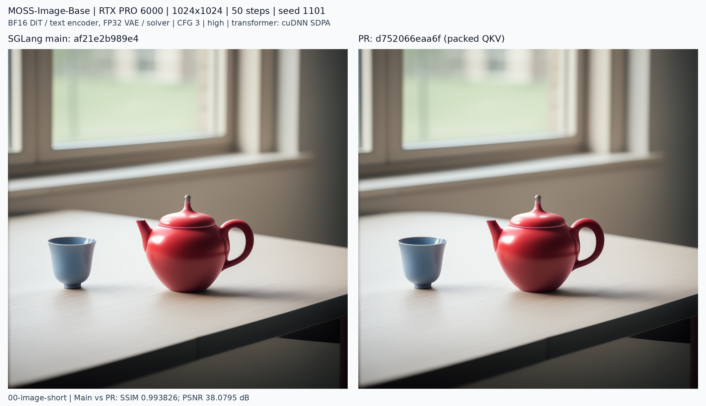
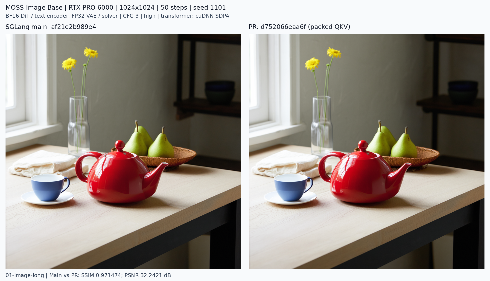
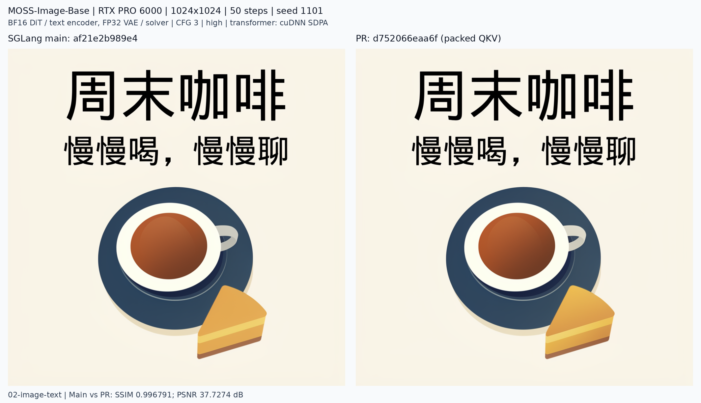

# MOSS packed QKV validation media

Actual images generated on one RTX PRO 6000 Blackwell Server Edition, using MOSS-Image-Base at checkpoint revision `85975793d8b3d432f1b6e27f352abaa4c2a4c0d3`.

- SGLang frozen main: `af21e2b989e482cfdce39689126562f2209d53ac`.
- Candidate: `d752066eaa6f5091fa4c8daa2ba1d5d43a3928cd`.
- 1024x1024, 50 steps, CPU generator seed 1101, CFG 3, flow shift 5, skip layer 22 with SLG window 0.01-1.0, batch/concurrency 1.
- Both use native eager high quality and transformer cuDNN SDPA, BF16 DiT/text encoder and FP32 VAE/solver.

Each complete source image is pasted at 1:1 pixel scale, unchanged, with captions outside the source bounds. `media-manifest.json` records original and composed SHA256 hashes. These are real serving outputs; no images were synthesized or retouched for this comparison. Main/PR high outputs are not pixel-identical. Three prompt numeric checks and a visual review are local qualification evidence, not a broad perceptual-equivalence claim. The exact inputs are in `moss-workloads.json`.

This branch holds evidence only and is independent of the source PR branch. The complete predeclared primary protocol is archived under `results/`: four temporal pairs give main/PR **1.014053x** and Omni/PR **1.022223x**, with all pairs positive, for the Base1024x1024/50-step short-prompt eager-high cell. PR peak NVML memory increases by74MiB. All12process quality gates and image/NVML audits passed. Other cells and BCG are not covered by this result. Final mode-switch, matched cuDNN profiles and separately instrumented native Omni prediction/Euler timers are archived under `diagnostics/`. All final lossless PNGs match main before and after high requests. Native Omni denoise-core p50 is14.417836s across4measuredrequests; its boundary excludes the surrounding Python loop/setup and is not used for the primary E2E ratio. The four-line diagnostic patch only configures existing profiler targets in a separate checkout; the primary Omni checkout remains unchanged.

