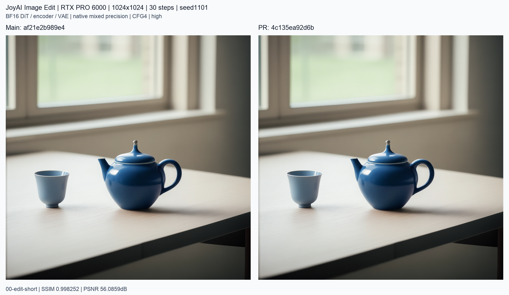
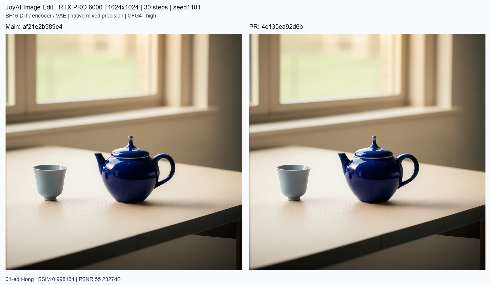
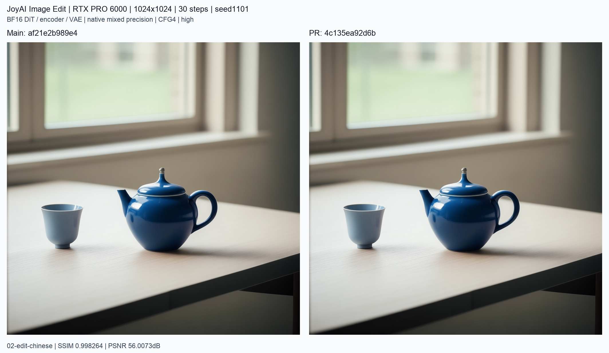
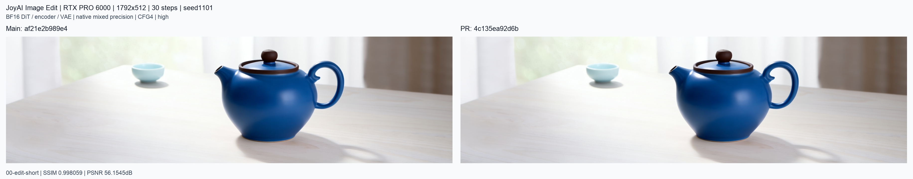
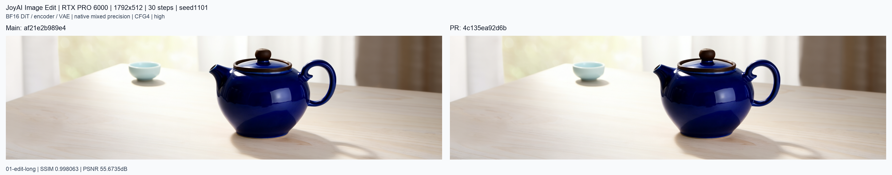
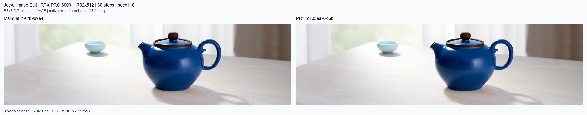

# Joy Image Edit: final SM120 image-MLP fusion evidence

This independent evidence branch documents the final three-file high-quality image-MLP optimization. It does not add media or traces to the code branch.

- Main `af21e2b989e482cfdce39689126562f2209d53ac`; final candidate `4c135ea92d6b4cbb0ead69bb39976f7dbe995455`; native vLLM-Omni `817d4c17feb702289a2d2b2cbacfd594c262b7a7`.
- Model `jdopensource/JoyAI-Image-Edit-Diffusers@4b41fb25d961f37668750178ccbb380da326201c`. All 36 runtime files are verified against frozen HF hashes after direct token-free ModelScope download.
- One RTX PRO 6000 Blackwell Server Edition, SM120, 97887 MiB, driver 595.84. Same physical GPU0 for all arms, GPU1 idle, batch/concurrency 1. No exclusive host lease: ownership is checked before/after blocks and sampled during requests.
- SGLang: Torch 2.14.1+cu130, Triton 3.8, cuDNN 9.24, diffusers 0.37. Omni: Torch 2.13+cu130, Triton 3.7.1, cuDNN 9.20, diffusers 0.40. Both transformers 5.19. Exact versions: `validation/*-version-pins.txt`.

## Final results

All final source/request/PNG hashes, quality gates and GPU ownership samples pass. Each shape uses main/PR/Omni/Omni/PR/main, two fresh processes and eight primary requests per arm. Every process first performs four quality requests and two explicit warmups. Main A/A and cleanup ABBA are separate. Existing compilation/disk caches are retained.

| Shape | Arm | Denoise p50 s | Primary HTTP p50 / p95 s | Sequential req/s | Peak sampled NVML MiB |
|---|---|---:|---:|---:|---:|
|1024×1024|main|35.6274|36.0095 / 36.0168|0.027770|60223.4|
|1024×1024|PR|34.9200|35.2994 / 35.3233|0.028328|59805.4|
|1024×1024|Omni native compile|37.1286*|37.7202 / 37.7281|0.026512|66735.4|
|1792×512|main|30.1285|30.4694 / 30.4866|0.032820|58747.4|
|1792×512|PR|29.5247|29.8698 / 29.8798|0.033479|58711.4|
|1792×512|Omni native compile|31.2797*|31.8228 / 31.8328|0.031424|65525.4|

Temporal-pair geometric main/PR ratios: 1.020039915× square and 1.020089949× wide. Omni/PR: 1.068434044× and 1.065273659×. Every pair exceeds the observed A/A envelope; this is a descriptive noise screen, not a confidence interval. NVML is sampled every 250 ms during requests, may miss transients, and is not startup-memory peak. Req/s is reciprocal mean latency at concurrency1, not saturation throughput. Cleanup latency changes −0.04894%/+0.02592% both pass the prospectively fixed 0.1% screen; mixed directions do not establish a cleanup speedup.

*Omni denoise is from a separate synchronized native `JoyImageEditPipeline.diffuse` diagnostic with metadata-only scheduler observer overhead. Neither diagnostic HTTP time nor kernel time contributes to primary ratios. Each diagnostic retains one native two-step startup call and ten actual thirty-step requests. Both final matched SGLang profile pairs show 162→82 standalone GELUs, 80 fused calls and 2306→2226 kernels per complete step. No BCG claim.

## Quality and precision

BF16 DiT/encoder/VAE, no quantization, 30 steps, CFG4, CPU seed1101, empty negative prompt, same reference/shape. Native intermediate arithmetic differs: SGLang main/PR have identical traced CFG/solver tails with BF16 projection/CFG arithmetic and FP32 norm normalization/solver update. Omni has autocast off and BF16 scheduler input/output with an internal FP32 sample upcast. Native VAE reference mode/sample and CFG clamp floors also differ; native cuDNN TF32/BF16 reduction defaults remain. This comparison does not claim identical intermediate arithmetic or isolate the cause of Omni repeat variation. The PR changes only high-mode MLP arithmetic.

V4 quality retains 48 declared outputs across square/wide/tall and short/long/Chinese/repeated prompts. Main/PR high min SSIM across shapes:0.998059; lossless after high restores main pixels exactly. Final primary adds 120 outputs: cross-framework min SSIM0.995885/0.994935 and PSNR46.0557/46.5333 dB for square/wide. Every Omni repeat is gated, with no rerolls or slow/failed-request selection. CPU input audits are under `validation/`.

Six panels contain complete real main/final-head output pixels at1:1, with labels outside image bounds. All were visually inspected; browser display may scale them. Manifests link panel hashes to source PNG hashes, commits and contracts. Shared baseline appearance changes remain.








## Reproduce

Use separate environments with the pinned versions/source SHAs. Mount a fresh task directory at `/task`. Place verified weights at `/task/cache/common/JoyAI-Image-Edit-Diffusers`, checkouts at `/task/repos/sglang`, `/task/candidates/joy-image-gelu` and `/task/repos/vllm-omni`. Copy `inputs/` and the `reproduce/*.py`/`*.sh` scripts to the corresponding `/task` paths. Start only one server at a time, stopping only its recorded owned PID before the next arm:

```bash
# Pinned main, in the SGLang environment.
SGL_REPO=/task/repos/sglang \
  JOY_CANDIDATE_SHA=af21e2b989e482cfdce39689126562f2209d53ac \
  sh /task/launch_sgl_joy_candidate.sh

# Final PR, in a fresh SGLang process.
SGL_REPO=/task/candidates/joy-image-gelu \
  JOY_CANDIDATE_SHA=4c135ea92d6b4cbb0ead69bb39976f7dbe995455 \
  sh /task/launch_sgl_joy_candidate.sh

# Native Omni, in its separate environment.
sh /task/launch_omni_joy_compile.sh
```

SGLang uses native resident eager, `transformer=torch_cudnn_sdpa`, no compile/BCG. Omni retains default regional compilation and CUDNN_ATTN. Saved launcher files give every environment and server flag. Against each running arm, use a unique qualification label:

```bash
python /task/submit_joy_candidate_qualification.py sgl \
  --label reproduction-main-square --quality high \
  --contract /task/inputs/joy-workloads.json

python /task/submit_joy_candidate_qualification.py omni \
  --label reproduction-omni-square --quality high \
  --contract /task/inputs/joy-workloads.json
```

Use the corresponding exact wide/tall JSON filename in `inputs/` for those shapes; tall is quality-only. After quality checks, `bench_joy_serving.py` sends the same frozen short prompt. Supply its required `--allowed-gpu-pids` from current NVML in the server environment, `--repo`, actual `--expected-sha`, `--quality high`, frozen `--contract`, a fresh `--run-id` and `--repeats 4 --warmups 2`. Every exact executed launch/qualification/benchmark command is in `results/raw/*/server/metadata.json`. Recreate A/A and the full paired order instead of choosing fastest requests.

Archived host controllers use the original host directory/container names and reject reused output IDs; they are provenance, not portable installers. Adapt paths to a fresh namespace and recreate references for a new machine. Do not overwrite archived results or reuse old PIDs. SGLang `submit_joy_candidate_qualification.py --profile` and the separate Omni profile launcher are diagnostic-only; never use them for primary E2E.

The real SM120 regression test passed1 with119 deselected:7168-token boundary numerical/dispatch behavior, high/lossless restoration, small-token fallback, actual dynamic input-projection LoRA lifecycle and `torch.compile(backend="eager",fullgraph=True)` fallback. This does not establish full-model Inductor performance. Ruff0.15.1/isort7, parse/diff and Mint validate/broken-links passed; logs under `validation/`.

## Provenance

- `results/`: all20 A/A, cleanup and final comparison blocks, complete timing/request/NVML/source metadata and original-response hashes.
- `diagnostics/`: four actual final traces, matched analyses, two native Omni stage/precision diagnostics and schema-admission amendment.
- `quality/`: numeric/visual v4 audits and gates. Full original responses and PNGs remain in local and remote task archives. Public response exports omit only repeated base64 image payloads, retaining all other fields and the original response SHA.
- `validation/joy-final-runtime-precision-audit.json`: final resolution of the frozen precision-audit placeholder; no frozen contract changed.
- `validation/runner-logs/`: original artifact-write permission failure, next controller's assertion failure from the extra native startup call, and successful explicit resume. Completed inference/traces were reused after hash checks; primary runs were not repeated or discarded.
- Earlier preparation files retain their historical pending statuses and timestamps. Final profile audits, raw diagnostic audits, runtime precision audit and terminal resume2 status establish completion.
- `downloads/`, `inputs/`, `reproduce/`: checkpoint provenance, frozen inputs and actual scripts. `evidence-files-sha256.json` hashes every public file except itself/Git metadata.

Scope: the two listed single-reference shapes, one SM120 GPU, batch/concurrency1. Other GPUs, larger/multiple references, quantized checkpoints, BCG and broader prompt sets are not model-performance claims.
