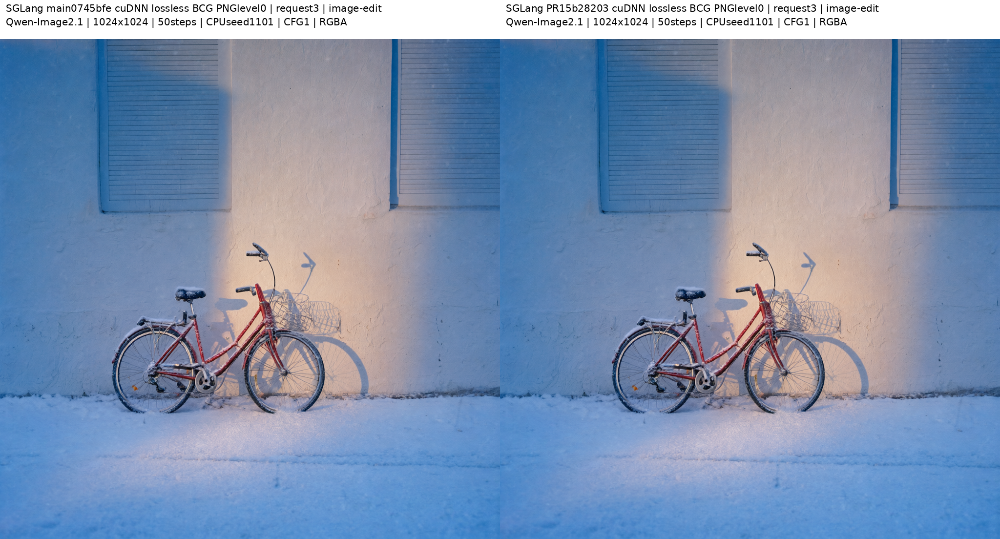
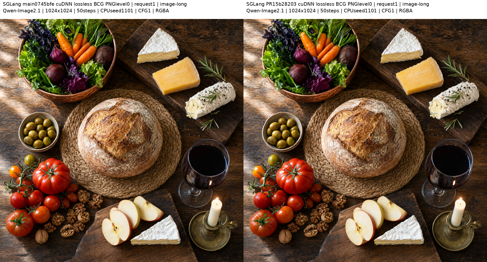
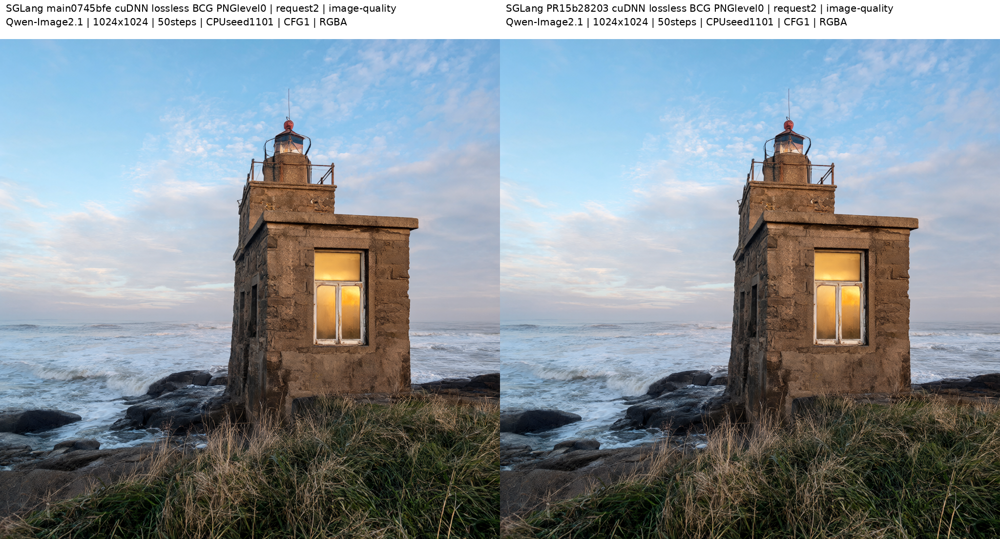
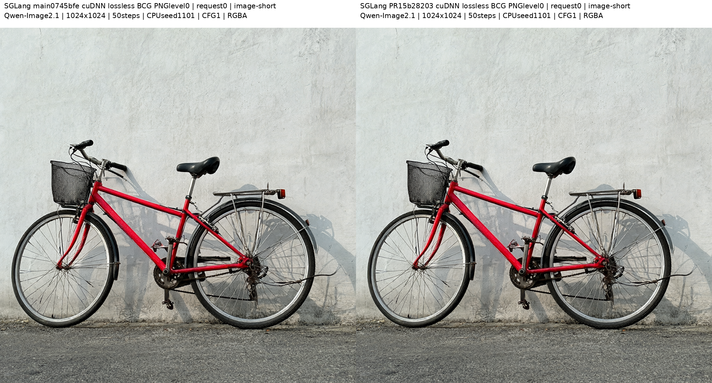
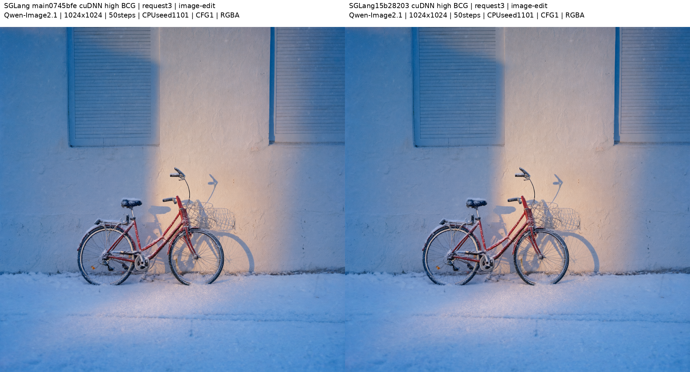
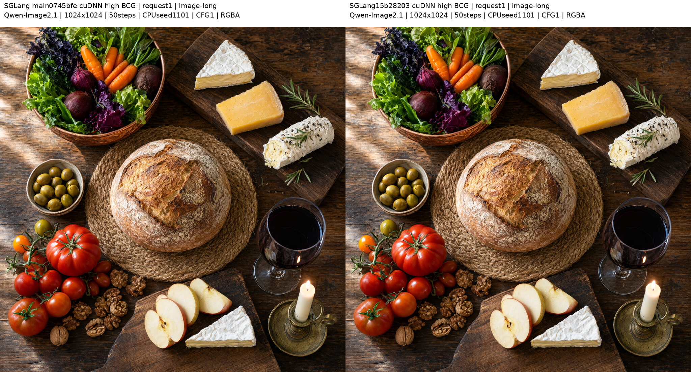

# Qwen-Image 2.1 request-owned BCG prefix reuse

Main `0745bfe49b855ae48e0c1ef3305362b8e0c78a03`; final PR `15b28203ba81c96fac1b3692d7bc67bac01d8ff5`; Omni `aa2968e858a718989332a61ad40758024cb4a3a5`.
Weights `Qwen/Qwen-Image-2.1@d26bb61231c349cf6b7896fa83353113880e1ba3`.

One RTX PRO 6000 Blackwell Server Edition, GPU0 UUID `GPU-1565b45e-a702-2015-9776-61f68c36fd59`, 97887 MiB, driver595.84. This task has a maximum two-GPU budget; these measurements use only GPU0. The two GPUs are SYS-connected without NVLink. No historical hardware performance is substituted.

## Final performance

Native BF16, 1024x1024 single-image edit, CPU seed1101, 50 steps, CFG1, batch1/concurrency1, full resident weights. Both encode actual PNG level0; this requires SGLang API compression0 and Omni API compression100. Decoded RGBA is unchanged from the earlier level9 SGLang artifacts. The PNG stored-block proof is archived.

| Arm | Denoise p50 (s) | Saved E2E p50 (s) | p95 (s) | Serial req/s | Peak allocated / reserved MiB | Sampled NVML MiB |
|---|---:|---:|---:|---:|---:|---:|
| SGLang main eager (separate AA) | — | 11.0374 | 11.0575 | 0.09059 | 37971 / 42126 | 43381 |
| SGLang main BCG | 11.4628 | 11.7024 | 11.7270 | 0.08541 | 43946 / 46976 | 48243 |
| SGLang PR BCG | 11.0951 | 11.3471 | 11.3751 | 0.08808 | 43946 / 46868 | 48135 |
| vLLM-Omni native defaults | 11.8302* | 12.3309 | 12.3609 | 0.08108 | — / 42304 | 43095 |

Each final paired arm has two fresh-process visits, two warmups and seven measured requests per visit (n=14). Eager/main A/A is E-M-M-E; final pairing is O-M-F-F-M-O. No profiler or audit hook runs during timing. Pair ordinal requests within first/second visits. Raw samples, exact command lines and dependencies are included under `runs/` and `inputs/`.

Main/PR paired geometric speedup: **1.031378x**, E2E reduction **3.042%**. Observed main/PR noise floor: **0.767%**.
Omni/PR paired geometric speedup: **1.086513x**; observed cross-framework noise floor **1.440%**. P95 and floors are descriptive, not confidence bounds. All samples remain present.

*Stage timers run separately from quiet performance. Main/PR denoise has six synchronized samples per arm. Omni denoise uses six earlier native full-loop `diffuse` timers with the same actual level0 encoding; it has a separate time window and instrumentation. Eager is context from A/A, not a paired PR/eager benefit proof. No new beneficial BCG scenario is counted.

Saved E2E includes synchronous POST through raw response write, base64 decode and PNG write without fsync; PIL validation and hashing are excluded. Serial throughput includes validation gaps between measured requests. NVML is sampled total-device memory; native allocated and reserved memory remain separate. Omni's `peak_memory_mb` means reserved MiB, not allocated.

Fresh-process launch/ready times and both post-ready warmup request times are in `startup-and-warmup.json`. On-disk kernel and OS weight caches are reused; these are not cold-machine startup measurements. Capture durations and actual replay counts are in the final summary. No peak allocated-memory saving is claimed.

## What changed and why

The existing BCG padder repacks immutable per-layer prefix K/V on every cached step. For this edit, each 4224-token packed tensor is 2.0625 GiB. The PR stores one `(bucket, prefix_kv, prefix_pad)` tuple in the existing request's first-layer cache, reuses it across cached steps and replaces it when warmup changes buckets. Prefill, attention, precision, static graph input copies and fallback guards are unchanged.

Final-head profile: prefix stack/zero count **49→1**, graph prefix input copies **49→49**. CatArrayBatchedCopy GPU duration **186.089→4.408 ms**. Profiles are attribution evidence, not latency benchmarks; raw compressed traces and shape-specific costs are included. No generic MoE or collective attribution is used for this single-GPU dense DiT.

## Quality and replay scope

Final main/PR PNG bytes and raw RGBA are exact for three T2I prompts, one edit and non-first short/edit repeats. Separate Torch SDPA lossless and cuDNN high admissions on the final head also match their own main references. High capture audit proves 32 actual packed BF16 MLP calls inside each of three real capture intervals. Each six-request BCG admission executes294 serving replays with zero serving capture; already-present warmup probes are distinguished from real graph capture.

The cross-framework RGBA gate is SSIM≥0.99 and PSNR≥40dB. Only the edit passes (SSIM 0.997115, PSNR 50.371dB). Bicycle, food and lighthouse quality failures remain in the matrix and the cross-framework quality directory. They receive no performance-win claim. This one cell does not establish a win over the full frozen95-pipeline/200-workload matrix.

Additional compatibility checks cover CFG2 text/edit, batch2 expected eager fallback, uncaptured768x768 expected fallback, return to the captured1024 shape, bucket replacement and release of request storage while graphs remain alive. No claim for Cache-DiT, quantized graphs, multi-GPU BCG or concurrent requests.

### Actual lossless main / PR output






### Actual high main / PR output

Main is on the left; the final PR `15b28203` is on the right. The separate [visual review receipt](visual-review.json) follows the unchanged numerical summaries.




All panels use the same prompt, CPU seed1101, 1024x1024, 50 steps and BF16. Labels distinguish lossless/high. Only display is composited over checkerboard; metrics compare original RGBA including alpha. Infinite PSNR for exact output is represented as null in JSON. Original admission PNGs are included.

## Cleanup and validation

Prototype `4b45ef7fd5b3106e577634561e7f6d5911632692` versus cleaned `718f582ed2680d45ad3c4c18dc283ed4b738b5c6` was measured on the same GPU/configuration in a separate balanced codec9 phase. Their paired speedup is 0.99990659x, within observed noise. This same-framework comparison remains valid despite the later cross-framework codec correction. Final15b changes only test formatting from718; runtime files are Git-identical and test AST is identical. Final15b then repeats the three full model admissions, corrected-codec timing, stages and profiles above.

All four changed files were self-reviewed and simplified. Final changed-file pre-commit,34 padding tests and3 real CUDA replay tests pass. Existing cookbook documentation is updated and documentation validation passed. Historical style source/review references are recorded in `evidence/history/cleanup-style.md`; no unrelated cleanup or dependency upgrade is in the code diff.

## Reproduction

The original task mount is `/task` in the two containers, backed by `/data/xyzhang/diffusion-6000-20261113`. Frozen source checkouts are `repos/sglang-main`, `repos/vllm-omni`; final code is `candidates/qwen21-bcg-prefix-release`. Pinned weights are at `/prior-task/cache/common/Qwen-Image-2.1` read-only. Adjust paths to your own verified checkout and checkpoint; retain all numerical/resource settings. `runs/*/server-identity.json` records the exact server argv, `visit.json` the explicit environment and request plan, and `pip-freeze.txt` the exact dependencies. Model input prompts and edit-input hash are in `inputs/qwen21-native-workloads.json`.

```bash
# Example recorded quiet visits; use a new output run directory for reproduction.
python3 scripts/qwen21-codec0-visits/run.py sgl qwen21-codec0-main-paired-01 inputs/qwen21-codec0-main-quiet-01.json
python3 scripts/qwen21-codec0-visits/run.py sgl qwen21-codec0-PR-paired-01 inputs/qwen21-codec0-PR-quiet-01.json
python3 scripts/qwen21-codec0-visits/run.py omni qwen21-codec0-omni-paired-01 inputs/qwen21-codec0-omni-quiet-01.json
```

The frozen full visit order is `inputs/qwen21-codec0-quiet-rule-01.json`. SGLang runs native cuDNN SDPA with no torch.compile/offload; Omni retains native cuDNN attention, regional compilation and VAE graphs. No opponent fast path is intentionally disabled. The supplied harness requires corresponding quality admission receipts and verified weights before benchmarking.

All generated raw responses, full request artifacts and original logs are preserved in the task's SHA-verified private archive. This public tree includes all timing samples, representative actual outputs, relevant logs, profiles and the complete frozen matrix with failures and untested cells. No weights, media or traces are part of the code PR diff.
