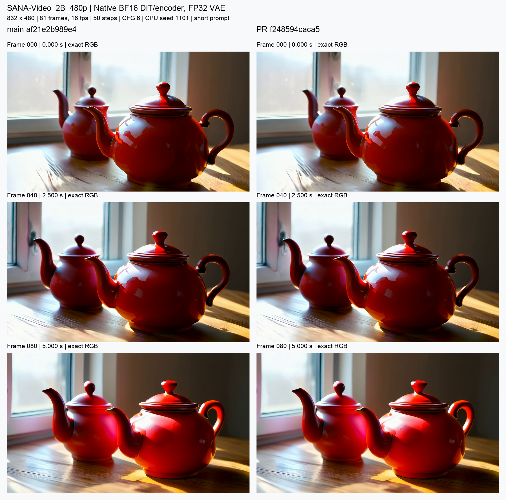
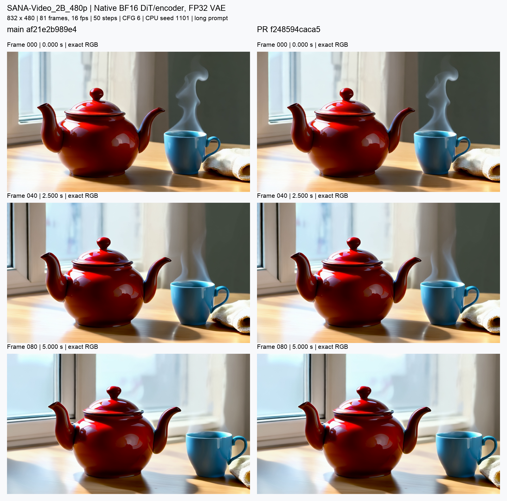
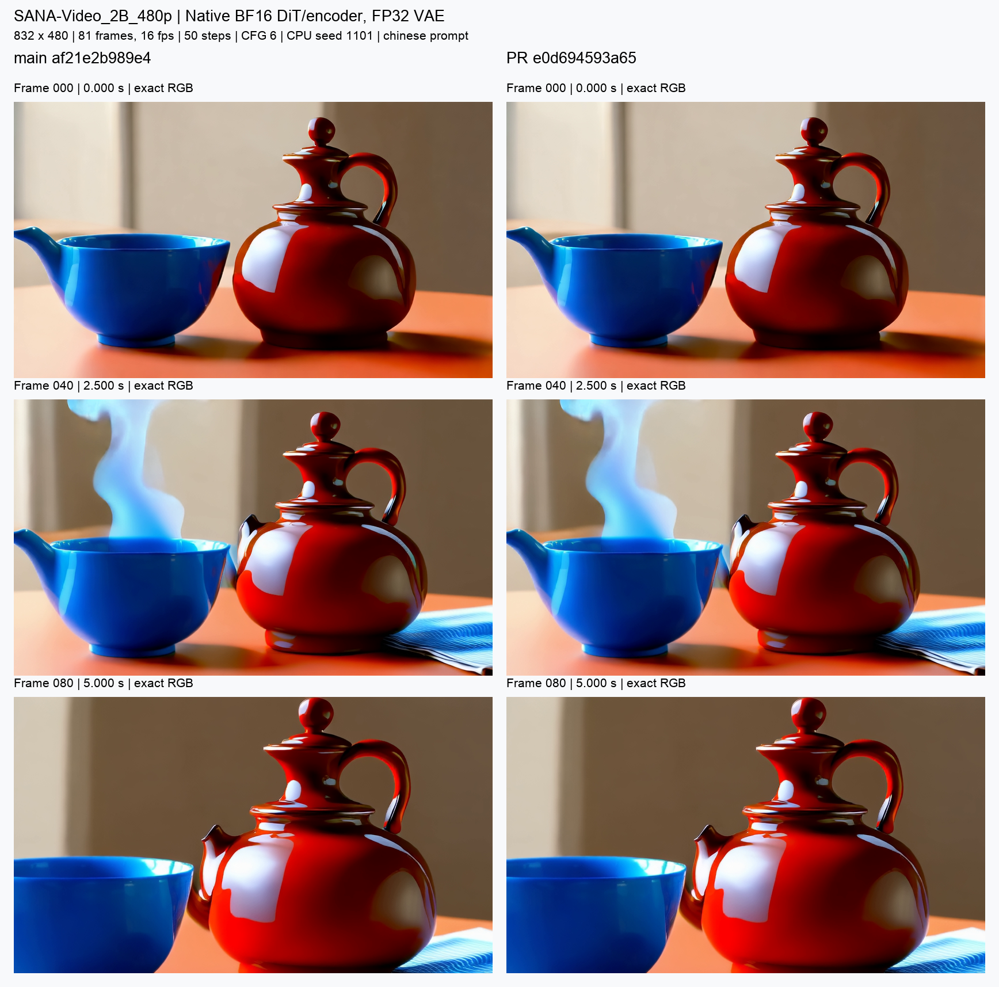
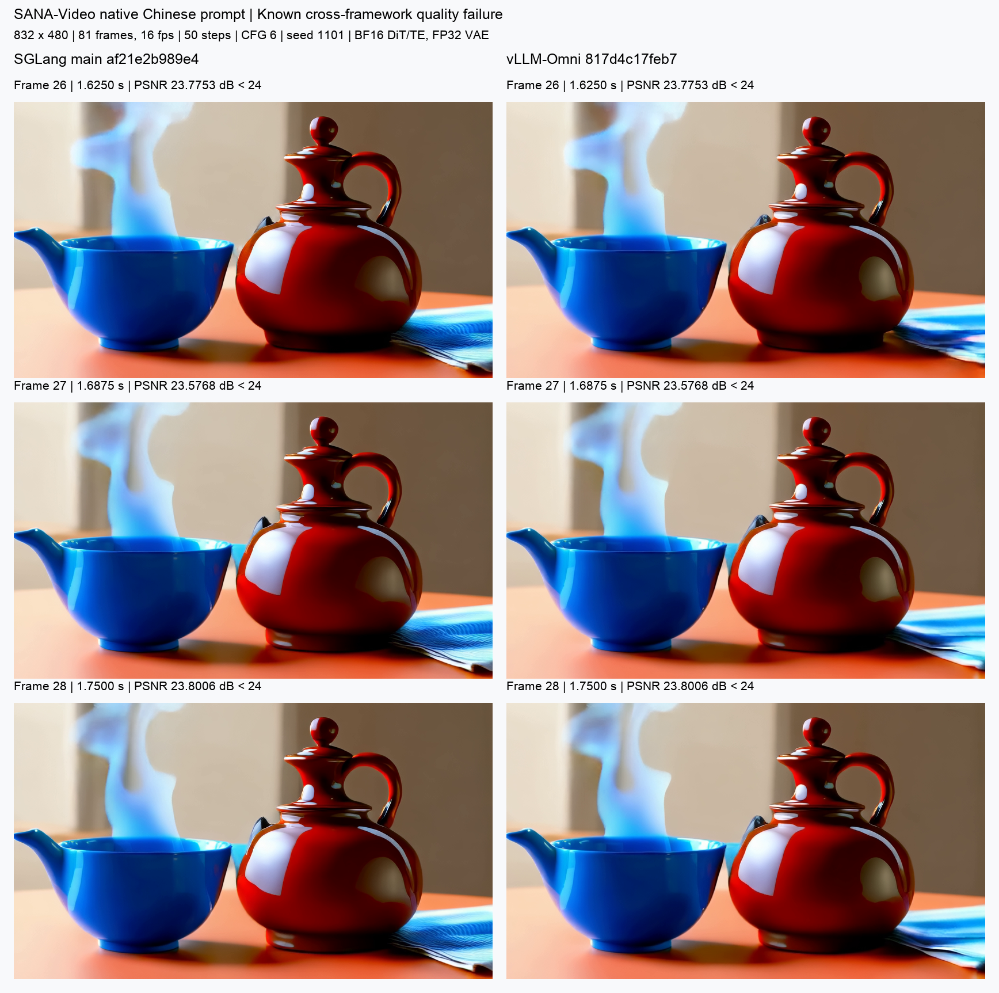

# SANA-Video depthwise convolution + GLU: evidence layout

Final-head primary/cleanup, compatibility, actual-frame review and archive verification gates passed before this export. The evidence branch is separate from production code; it contains no model weights. Upstream review/CI and visible PR-page media are separate submission gates.

The production change fuses the SANA-Video channel-last BF16 3×3 depthwise convolution, bias and GLU. Four adjacent output rows reuse input loads. FP32 accumulation order and intermediate BF16 rounding preserve the native inference path. Dispatch is restricted to the tested SM120 inference conditions and uses the existing per-signature exactness gate. Unsupported layouts, convolution settings, gradients, compilation and disabled cuDNN retain the reference path. An unseen signature during capture also uses the reference. SANA-WM is unchanged.

- Frozen SGLang main: `af21e2b989e482cfdce39689126562f2209d53ac`.
- Final cleanup head: `f248594caca5c533c94612b6848ff3512ed98e08`.
- Frozen vLLM-Omni: `817d4c17feb702289a2d2b2cbacfd594c262b7a7`.
- Checkpoint: `Efficient-Large-Model/SANA-Video_2B_480p_diffusers@db5f398b13ca086d09a50ce156c20527773841b1`.
- One physical RTX PRO 6000 Blackwell Server Edition GPU 0, SM120; GPU 1 idle. Native BF16 DiT/text encoder and FP32 VAE. Workload: 832×480, 81 frames at 16 fps, 50 steps, CFG 6, CPU seed 1101, batch/concurrency 1. Exact prompts and output encoding are in [the workload](inputs/sana-video-480p-t2v-workloads.json).

## Results and scope

Read [the final table](performance-table.md), [primary/cleanup admission](evidence/preflight/sana-video-depthwise-final-primary-cleanup1-admission.json), [summary](evidence/preflight/sana-video-depthwise-final-summary1.json), and [frozen sequence](evidence/plans/sana-video-depthwise-final-primary-cleanup1.json). All predeclared requests and process pairs remain available. The V1 worktree is the pre-cleanup candidate. Primary HTTP E2E, separate synchronized stage timings and cached launch costs are distinct measurements.

The primary sequence is M–V1–F–O–V1–F–F–V1–O–F–V1–M. Each process has one excluded warmup and three measured requests per English prompt. Main/Omni have n=6 and V1/final n=12 per prompt. Cleanup uses four process pairs, with mean regression bounded by fresh A/A noise and paired-log-t 95% regression upper bound below 0.1%. Failures and uncertainty cannot be removed or admitted by changing these thresholds.

The [native cross-framework quality](evidence/preflight/sana-video-native-cross-quality1.json) and [runtime input audit](evidence/preflight/sana-video-runtime-input-audit1.json) preserve token/mask, noise and schedule checks and later numerical differences. English workloads passed the frozen quality criteria. Chinese cross-framework PSNR fails on frames 26–28; it remains in quality/media/matrix records and is excluded from primary timing admission. Other shapes, batch/concurrency and two-GPU scenarios remain unrun. This independent change does not include the separate eager-LN PR.

[Compatibility admission](evidence/preflight/sana-video-depthwise-final-compatibility1-admission.json) covers the final head's same-quality main/PR outputs, repeated requests, prompt/quality transitions and BCG lifecycle. [Actual profile attribution](evidence/preflight/sana-video-depthwise-final-profile1.json) joins CPU launch correlations to GPU kernels, including graph kernels. Existing BCG compatibility is not a claim of a new beneficial BCG scene. All times from observer/profiler runs are diagnostic.

Omni denoise/decode uses the [previously archived native stage diagnostic](evidence/preflight/sana-video-omni-stages1-admission.json) at the unchanged frozen source, checkpoint and configuration; primary E2E is measured anew. Its first HTTP request is retained but excluded from the representative steady stage summary (n=1 per English prompt). The original collector's extra startup-forward count failure and the corrected offline classification are both retained. This supplement did not alter model arithmetic.

The numerical/dispatch/CPU-compile commands and return codes are in [the test receipt](evidence/block-runs/sana-video-depthwise-final-tests1/results.json). CPU fullgraph tracing uses CPU tensors with CUDA visible for the existing import-time device query; it is not compiled GPU performance evidence. Scoped local checks do not imply upstream GPU CI passed.

## Actual generated media

These panels use actual final/main requests at frames 0/40/80, corresponding to 0/2.5/5 seconds. Source commits, video hashes and all decoded-frame hashes are recorded in [the manifest](media/manifest.json). [Manual review](media/visual-review.json) covers the displayed frames, not full motion.







Original videos: [short main](media/videos/short-main.mp4), [short PR](media/videos/short-pr.mp4), [long main](media/videos/long-main.mp4), [long PR](media/videos/long-pr.mp4), [Chinese main](media/videos/chinese-main.mp4), [Chinese PR](media/videos/chinese-pr.mp4). [Video identities](actual-main-pr-videos.json) record the original paths and source commits.

The retained native main/Omni Chinese quality failure is shown at frames 26–28 below. Frame 27 has the worst PSNR, 23.5768 dB, below the frozen 24 dB threshold. All 81 original frame hashes per video were verified with the original common decoder before exporting these frames. The [manifest](evidence/media/sana-video-native-cross-worst1/manifest.json) and [visual review](evidence/media/sana-video-native-cross-worst1/visual-review.json) preserve provenance and the failed conclusion. The initial Mac decoder failed the RGB-hash guard; its failure and the later console-summary-only failure are retained. This supplement was created after the main qualification archive and is separately hashed in the public evidence manifest.



The displayed outputs retain shared model artifacts, including extra teapots, double spouts and malformed stacked lid/cup geometry. Exact main/PR output agreement does not imply semantic perfection. Neither these representative panels nor the three worst-frame samples establish a full-motion review.

## Reproduction and provenance

The recorded host root is `/data/xyzhang/diffusion-rtx6000-20261026`, mounted as `/task` in the owned SGLang and Omni containers. Launchers select exact source worktrees through `PYTHONPATH`. [Image identities](evidence/preflight/sana-video-container-image-identities1.json), [dependency provenance](evidence/preflight/sana-video-dependency-provenance1.json), [SGLang install record](sgl-pip-freeze.txt) and [Omni install record](omni-pip-freeze.txt) disclose the environments, including local-image/wheel limitations.

Use a fresh reproduction location with equivalent mounts. Install `reproduce/` scripts at the host root and plans where each runner expects them; restore the exact source heads and the [V1 patch](evidence/preflight/sana-video-depthwise-glu-v1.patch). Obtain the pinned checkpoint from its original repository or the original-hash-verified mirror plan. Do not change native component configurations or send credentials to a public mirror.

```bash
# Inside the pinned SGLang container, select the final worktree:
sh /task/launch_sgl_sana_video_depthwise_final_primary1.sh
# A separate client can inspect the recorded benchmark arguments:
python3 /task/bench_sana_video_serving1.py --help

# Host-side serial paired runner, after restoring required references/admissions:
python3 /data/xyzhang/diffusion-rtx6000-20261026/run_sana_video_blocks1.py \
  /data/xyzhang/diffusion-rtx6000-20261026/sana-video-depthwise-final-primary-cleanup1.json
```

Stop the example manual server before starting the serial runner. Exact commands, payload hashes, clean/patch source identities and process metadata are preserved in `evidence/block-runs`. Guards deliberately reject changed sources, occupied GPUs and existing output folders; do not disable them to make a changed experiment appear equivalent.

Local evidence paths `evidence/qualification`, `evidence/benchmarks`, `evidence/diagnostics` and `evidence/profiles` correspond to the host's `outputs/` directories. Media are deduplicated by content hash, and large logs are losslessly gzipped; [the original-path map](original-path-map.json) restores their locations. [Omitted binaries](omitted-binary-files.json) identify tensor snapshots and Git bundles retained in verified local archives. [Archive manifests](archive-manifests) and `evidence-files-sha256.json` preserve all hashes. Failed FMA-order probes, slower first kernels and the initial pre-GPU worktree-preparation failure are retained. Weights, traces and media are outside the production code diff.
