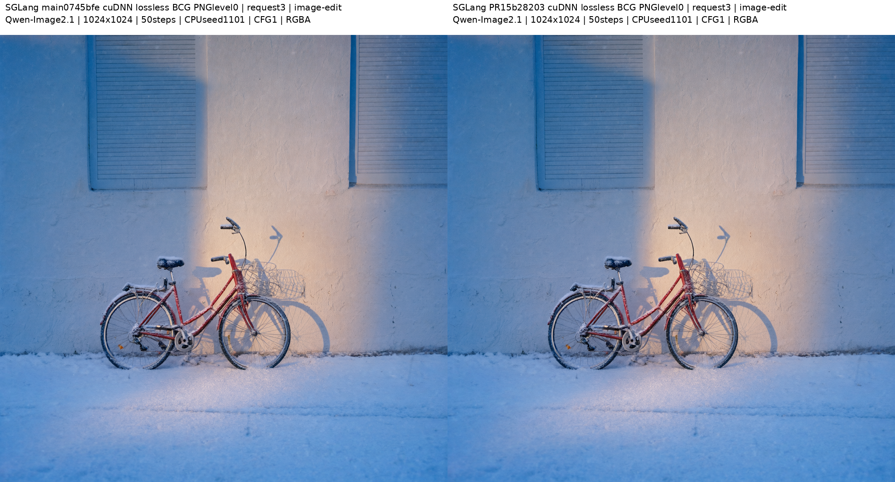
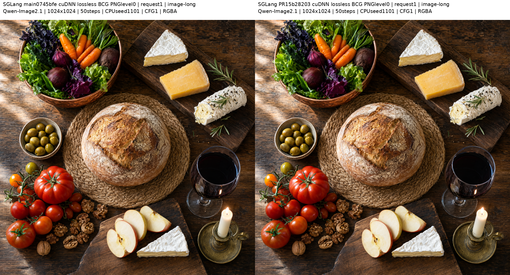
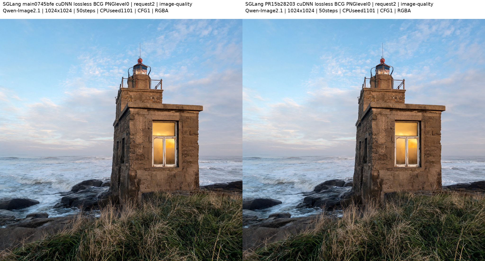
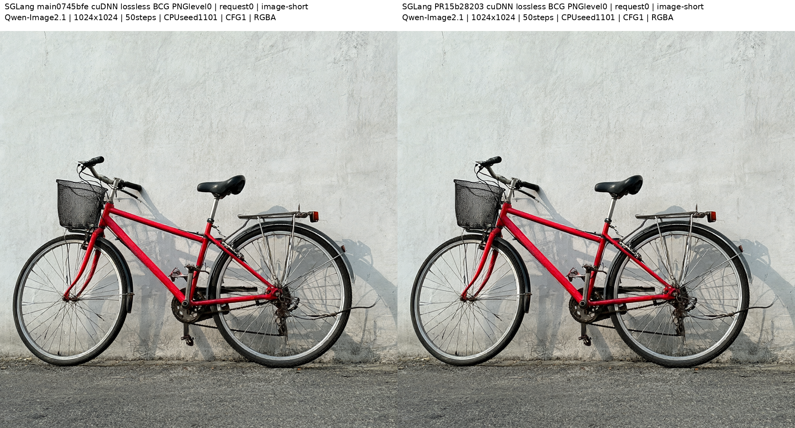
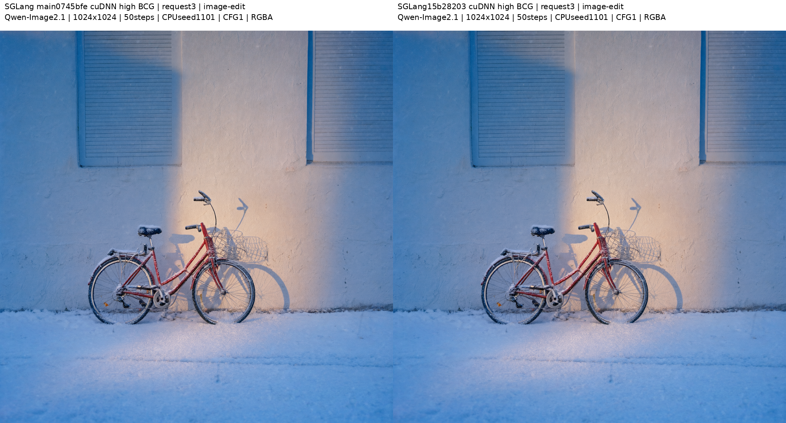
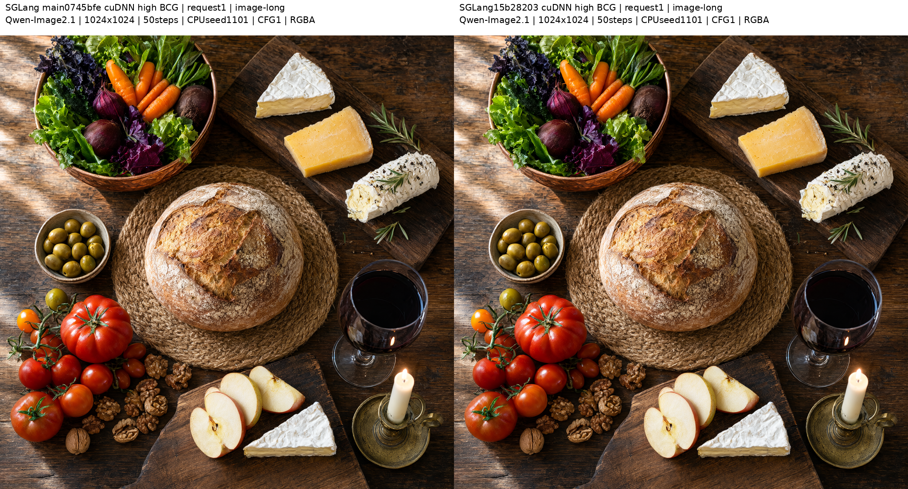

**Evidence availability update:** the three-round report below includes every measured latency sample and every round, with original source heads unchanged. Complete raw archives were created on the 6000 host with per-file SHA256 receipts. SSH interrupted the local archive copies on 2026-11-15; this supplement publishes the verified reports, commands and hash manifests available locally. The remaining raw-file mirror is pending reconnection. Previously published actual main/PR images and videos remain available. The supplemental raw-file mirror remains incomplete; the previous raw archive and generated comparisons remain available.

## Motivation

Qwen-Image 2.1 prefills its condition prefix once, but BCG repacks the immutable per-layer K/V before every cached denoising step. A 1024² image edit with a 4224-token bucket stacks, zero-fills and copies a 2.0625 GiB prefix 49 times in a 50-step request.

This change keeps one packed prefix in the existing request cache. The graph still copies its inputs on every replay; this removes repeated packing, without changing attention, model precision or the number of denoising steps.

## Modifications

- Keep `(bucket, prefix_kv, prefix_pad)` in the first layer's request cache. Reuse it within that request and replace it when warmup selects a different bucket. No global cache or new flag.
- Preserve eager prefill and the existing batch, SP and oversized-prefix guards. Drop the request cache from forwarded graph arguments as before.
- Extend the existing padding and real CUDA replay tests to cover bucket replacement, changed prompts, repeated timesteps and release of request storage while captured graphs remain alive. Document the BCG scope in the existing Qwen 2.1 cookbook.

This is separate from [#46101](https://github.com/sgl-project/sglang/pull/46101), which reuses native per-layer packed QKV output buffers, and [#40472](https://github.com/sgl-project/sglang/pull/40472), which fixes Cache-DiT's per-layer cache selection.

## Accuracy Tests

Frozen SGLang main: `0745bfe49b855ae48e0c1ef3305362b8e0c78a03`.
Final PR head: `15b28203ba81c96fac1b3692d7bc67bac01d8ff5`.
vLLM-Omni: `aa2968e858a718989332a61ad40758024cb4a3a5`.
Weights: `Qwen/Qwen-Image-2.1@d26bb61231c349cf6b7896fa83353113880e1ba3`.

All final-head admissions use native SGLang. For both Torch SDPA and cuDNN SDPA, lossless main/PR PNG bytes and decoded RGBA match exactly. The separate high-quality lane also matches its high main reference exactly. Three T2I prompts, one image-edit prompt and non-first short/edit repeats are included. Exact comparisons have max absolute error 0 and infinite PSNR. The archived TorchMetrics implementation reports SSIM 0.9999953–0.9999965 even on these identical images because of floating-point metric arithmetic; PNG and raw-RGBA equality are checked directly.

BCG admission prewarms buckets 64/384/4224 at 1024². Each six-request admission has 294 actual serving replays and no serving capture. The high lane records execution of the packed BF16 MLP inside each of the three actual graph captures. Additional main/PR checks cover true CFG=2 text/edit (98 replays each), batch=2 and an unwarmed 768² shape (49 expected signature misses/eager fallbacks each), then return to the original 1024² shape (49 replays, original output unchanged). No BCG+Cache-DiT, multi-GPU, quantized or concurrent-serving compatibility is claimed.

The frozen cross-framework RGBA gate is SSIM ≥0.99 and PSNR ≥40 dB. The edit passes (SSIM 0.997115, PSNR 50.371 dB). The three T2I cases fail and remain visible:

| Prompt | SGLang cuDNN vs Omni SSIM | PSNR (dB) | Performance eligibility |
|---|---:|---:|---|
| Bicycle | 0.993446 | 38.584 | Failed quality gate |
| Food | 0.993244 | 39.122 | Failed quality gate |
| Lighthouse | 0.981045 | 32.302 | Failed quality gate |
| Snow edit | 0.997115 | 50.371 | Admitted |

Actual Qwen-Image 2.1 outputs below: **main on the left, final PR `15b28203` on the right**. Each pair uses the same prompt, CPU seed 1101, 1024×1024, 50 steps, CFG=1 and BF16. The upper pairs are lossless; the last two are the separate high lane. All six pairs have identical PNG bytes and raw RGBA. Numerical comparison precedes checkerboard composition for display.

**Lossless image edit: main / PR**



**Lossless long prompt: main / PR**



**Lossless lighthouse: main / PR**



**Lossless short prompt: main / PR**



**High image edit: main / PR**



**High long prompt: main / PR**



The [worst cross-framework sample, lighthouse](https://github.com/BBuf/sglang/blob/f04c6e867dfd5229fbb4665ba33049db64807d75/evidence/quality/qwen21-codec0-cross-framework-01/cross-image-quality/comparison.png) has visible roof/upper-structure differences and fails the gate; the full metrics and all failed samples remain public.

The extra CFG/batch/fallback checks ran on cleaned head `718f582e`; its runtime files are Git-identical to final `15b28203`, whose only later change formats one test assertion. The three final-head full-model admissions and final-head padding/CUDA tests were rerun.

## Speed Tests and Profiling

One physical RTX PRO 6000 Blackwell Server Edition, 97,887 MiB, SM120, driver 595.84, GPU UUID `GPU-1565b45e-a702-2015-9776-61f68c36fd59`. Same GPU and full resident weights in every arm. SGLang uses native cuDNN SDPA, lossless BCG, no torch.compile and no offload. Omni retains its native cuDNN attention, regional compilation and VAE graphs. Exact CLI, dependency versions and input files are archived with every visit.

The final actual-codec0 comparison now retains **three independent `Omni–main–PR–PR–main–Omni` rounds**. The original published round is retained; two prospectively declared rounds use unchanged commits and settings, preceded by fresh `Omni–main–main–Omni` A/A. Each fresh process has two excluded warmups and seven measured full-step edits: **six process visits and n=42 measurements per paired arm**. Corresponding request ordinals are paired within each round.

SGLang API compression 0 and Omni API compression 100 select the same actual PNG level 0. Original same-API-100 cross-framework E2E remains ineligible because it selected SGLang level 9 versus Omni level 0. The earlier same-framework cleanup comparison remains valid. No profiler/audit hook, task-owned bulk transfer or heavy host analysis runs during quiet timing; foreign GPU processes are rejected. P95 and ranges are descriptive, not production tail bounds.

| Arm | Denoise p50 (s), separate timing | Saved E2E p50 (s) | E2E p95 (s) | Serial req/s range | Peak allocated / reserved MiB | Sampled NVML MiB |
|---|---:|---:|---:|---:|---:|---:|
| SGLang main eager, original separate A/A reference | — | 11.0374 | 11.0575 | 0.09059 | 37971 / 42126 | 43381 |
| SGLang main BCG | 11.4628 | 11.6971 | 11.7266 | 0.085392–0.085475 | 43946.18 / 46976 | 48243 |
| SGLang PR BCG | 11.0951 | 11.3379 | 11.3714 | 0.088050–0.088216 | 43946.18 / 46868 | 48135 |
| vLLM-Omni native defaults | 11.8302* | 12.3196 | 12.3590 | 0.081070–0.081171 | — / 42304* | 43095 |

| Paired comparison | Geometric speedup | E2E reduction | Observed descriptive noise | Gain exceeds noise |
|---|---:|---:|---:|---|
| main/PR | 1.031755x | 3.078% | 0.910% | True |
| omni/PR | 1.086620x | 7.971% | 1.163% | True |

| Paired comparison | Round 1 | Round 2 | Round 3 | Whole-round bootstrap 95% interval |
|---|---:|---:|---:|---:|
| main/PR | 1.031378x | 1.031770x | 1.032116x | [1.031463, 1.032042]x |
| omni/PR | 1.086513x | 1.086470x | 1.086876x | [1.086480, 1.086798]x |

Bootstrap units are entire balanced rounds: three units and 27 possible draws give limited resolution. Observed noise is the larger of fresh A/A drift/range and either paired arm's pooled full range. No samples are excluded. [All rounds, individual samples, A/A, startup and source receipts](evidence/benchmarks/qwen21-three-rounds35.json). All 198 outputs in this report (162 from final rounds and 36 from fresh A/A, including warmups) match their own admitted reference PNG exactly. Earlier quiet, cleanup and 20 separate stage outputs remain archived. SGLang allocator maxima above include every native checkpoint in the final visits; Omni reserved memory marked * is from the original separate memory evidence, while NVML is freshly sampled in all six final visits.

*Main/PR denoise uses six synchronized samples per arm in a separate M-F-F-M sequence. Omni denoise uses six earlier native full-loop `diffuse` samples with the same actual PNG level0, from a separate time window and instrumentation. Omni's native `peak_memory_mb` measures reserved memory, not allocated memory. No peak allocated-memory reduction is claimed.*

Cleanup was measured separately on this same GPU/configuration with balanced prototype/main/cleanup visits. Prototype `4b45ef7fd5b3106e577634561e7f6d5911632692` versus cleaned `718f582ed2680d45ad3c4c18dc283ed4b738b5c6` has paired speedup **0.99990659×**: cleanup is about **0.00934% slower**, within the observed noise. Outputs remain exact. These same-framework measurements used actual PNG level9 in both arms, so they remain valid. Final `15b28203` then repeated the corrected-codec full-model measurements, denoise timing and profiles reported above. All four changed files were self-reviewed; this diff contains no benchmark harness, media, dependency upgrade or unrelated cleanup.

Saved-request E2E runs from the synchronous HTTP POST through response JSON/base64 decoding and PNG byte writing; it excludes pixel decoding and hashing and does not call fsync. Serial throughput includes the validation gaps between measured requests. Synchronized native stage timings are collected in separate visits and do not replace quiet E2E. Omni's default `stage_gen_time / steps` is not used as a denoise measurement. Native allocator snapshots and sampled total-device NVML memory are reported separately.

Final-head profiles show prefix `stack`/zero-fill **49 → 1** per request, with static graph-prefix copies **49 → 49**. Edit `CatArrayBatchedCopy` GPU time falls **186.089 → 4.408 ms**. Profiling is separate from timing; these durations explain attribution, not E2E performance.

| Startup/capture cost | Main BCG | PR BCG |
|---|---:|---:|
| Fresh-process launch-to-ready, six final visits | 47.485–49.661 s | 47.433–51.826 s |
| First post-ready warmup E2E | 11.916–11.933 s | 11.558–11.582 s |
| Second post-ready warmup E2E | 11.617–11.641 s | 11.246–11.264 s |
| Three separately audited capture intervals, seconds | 0.581 / 0.429 / 0.437 | 0.574 / 0.431 / 0.439 |
| Actual serving replays / serving captures, separate six-request admission | 294 / 0 | 294 / 0 |

These are fresh processes with disk kernel/OS weight caches reused, not cold-machine startup. Main eager launch-to-ready is 47.448–47.846 s; Omni's six final visits launch in 32.422–34.584 s, with post-ready warmups 15.556–15.630 s then 12.212–12.222 s. BCG adds roughly 6 GiB allocated memory versus eager; the PR preserves that cost. The high lane audit distinguishes three real captures, each executing 32 packed BF16 MLP calls, from 144 already-present warmup probes. No serving recapture occurs when switching the short/long prompts at fixed spatial shape.

**No new beneficial BCG scene is established.** PR BCG p50 is 11.3379 s; the original separately measured eager reference is 11.0374 s. The new repetitions compare the BCG arms, not a fresh paired eager/BCG experiment. Eager remains the cookbook recommendation. Only the edit cell passes cross-framework quality; these results do not establish the suggested 1.10x aggregate or three 1.20x wins across the frozen 95-pipeline/200-workload matrix. No claim is made for quantization, Cache-DiT, multi-GPU BCG or concurrent serving.

[Immutable evidence index](https://github.com/BBuf/sglang/blob/f04c6e867dfd5229fbb4665ba33049db64807d75/README.md) · [three-round raw samples and summary](evidence/benchmarks/qwen21-three-rounds35.json), [original round](https://github.com/BBuf/sglang/blob/f04c6e867dfd5229fbb4665ba33049db64807d75/evidence/benchmarks/qwen21-codec0-final-01/summary.json) · [profiles and digest](https://github.com/BBuf/sglang/blob/f04c6e867dfd5229fbb4665ba33049db64807d75/profile-digest.json) · [complete matrix including failures and gaps](https://github.com/BBuf/sglang/blob/f04c6e867dfd5229fbb4665ba33049db64807d75/results-matrix.json) · [artifact hashes](https://github.com/BBuf/sglang/blob/f04c6e867dfd5229fbb4665ba33049db64807d75/artifact-manifest.json).

The evidence tree includes per-visit exact server argv, environment, dependency versions, prompts, edit-input PNG/hash, quality metrics, capture/replay audit, original PNGs and raw compressed traces. It records Torch 2.14.1+cu130 for SGLang versus 2.14.0+cu130 for Omni; Omni uses vLLM 0.33.0 and preloaded cuDNN 9.25.1; SGLang uses cuDNN 9.24.0. The separately preloaded Omni cuDNN is recorded in `server-identity.json`; it is not the 9.24.0 package listed by `pip-freeze.txt`. See both receipts for complete versions.

Run on the 6000 host after restoring the documented `/task` mounts, frozen repositories, verified weights and container environments. Use **new** run IDs because the harness refuses to overwrite evidence:

```bash
python3 scripts/qwen21-codec0-visits/run.py sgl qwen21-repro-main-01 inputs/qwen21-codec0-main-quiet-01.json
python3 scripts/qwen21-codec0-visits/run.py sgl qwen21-repro-PR-01 inputs/qwen21-codec0-PR-quiet-01.json
python3 scripts/qwen21-codec0-visits/run.py omni qwen21-repro-omni-01 inputs/qwen21-codec0-omni-quiet-01.json
```

Repeat in the frozen [E-M-M-E then O-M-F-F-M-O order](https://github.com/BBuf/sglang/blob/f04c6e867dfd5229fbb4665ba33049db64807d75/inputs/qwen21-codec0-quiet-rule-01.json); retain two warmups and seven measurements per visit. The harness verifies physical GPU UUID, clean source SHA, weight receipts, admitted output hashes and no foreign GPU process. Adapt only host/container paths for another machine. [Exact PR plan](https://github.com/BBuf/sglang/blob/f04c6e867dfd5229fbb4665ba33049db64807d75/inputs/qwen21-codec0-PR-quiet-01.json) and corresponding main/Omni plans disclose all numerical settings.

All full raw responses and generated artifacts also remain preserved in the task archive; no model weights or large evidence files are in the code diff.

## Checklist

- [x] Final changed-file pre-commit checks pass.
- [x] Padding suite and real CUDA replay tests on final head.
- [x] Existing cookbook updated; Mintlify validation and broken-link check pass.
- [x] Final-head paired performance and cleanup comparison complete.
- [x] Actual main/PR media embedded and verified visible on the PR page (all six images loaded and visually checked).

The added rounds use [the prospectively declared queue](inputs/qwen21-repeat34-queue.json) and the same visit harness. Reproduce fresh A/A and all three balanced rounds with new run names; analyze with `scripts/analyze_protocol_rounds35.py qwen21` after updating the run mapping in a separate evidence workspace. The original failed controller 34 stopped before any visits after an unrelated predecessor failed; recovery 34b ran the unchanged queue in full. Both controller receipts are retained.

[Full matrix snapshot before this publication update, including untested, failed and zero-gain cells](evidence/results-matrix-before-publication48.json). The qualified-PR count in that timestamped snapshot remains pending this public update and rendered-media verification.
